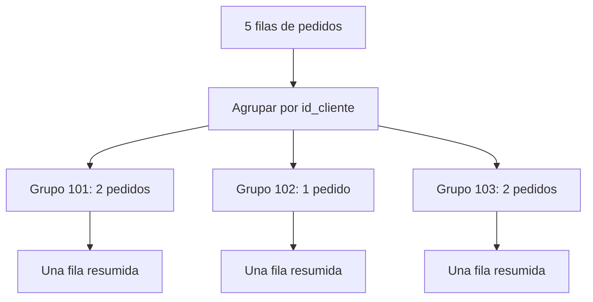
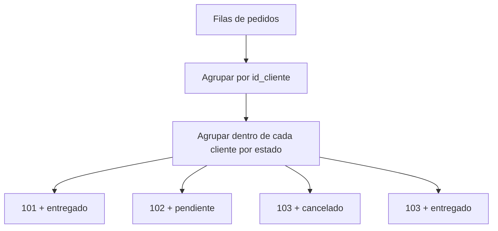
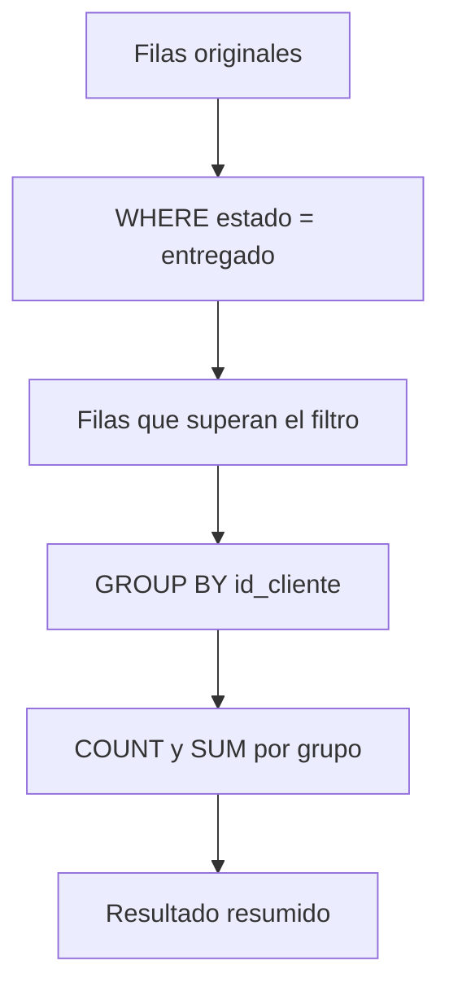
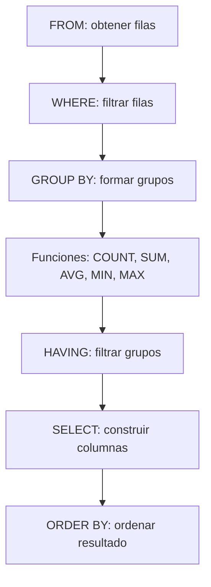

# `GROUP BY` y funciones de agregación

`GROUP BY` permite agrupar filas que comparten un mismo valor para calcular información resumida sobre cada grupo.

Las funciones de agregación reciben varias filas y producen un resultado por grupo:

- `COUNT`: cuenta filas o valores.
- `SUM`: suma valores.
- `AVG`: calcula promedios.
- `MIN`: obtiene el valor mínimo.
- `MAX`: obtiene el valor máximo.

```sql
SELECT columna_grupo, FUNCION_AGREGADA(columna)
FROM tabla
GROUP BY columna_grupo;
```

> **Idea central.** `GROUP BY` transforma muchas filas detalladas en una fila resumida por cada grupo.

---

## 1. Tablas de ejemplo

Usaremos las tablas `clientes`, `pedidos` y `productos`.

### `clientes`

```sql
CREATE TABLE clientes (
    id_cliente INT PRIMARY KEY,
    nombre VARCHAR(100) NOT NULL,
    ciudad VARCHAR(80)
);
```

```sql
INSERT INTO clientes (id_cliente, nombre, ciudad)
VALUES
    (101, 'Ana', 'Lima'),
    (102, 'Luis', 'Cusco'),
    (103, 'Marta', 'Lima'),
    (104, 'Carlos', 'Arequipa');
```

| id_cliente | nombre | ciudad |
| ---: | :--- | :--- |
| 101 | Ana | Lima |
| 102 | Luis | Cusco |
| 103 | Marta | Lima |
| 104 | Carlos | Arequipa |

### `pedidos`

```sql
CREATE TABLE pedidos (
    id_pedido INT PRIMARY KEY,
    id_cliente INT,
    fecha_pedido DATE,
    estado VARCHAR(30),
    total DECIMAL(10,2)
);
```

```sql
INSERT INTO pedidos
    (id_pedido, id_cliente, fecha_pedido, estado, total)
VALUES
    (1001, 101, '2026-10-01', 'entregado', 149.90),
    (1002, 102, '2026-10-02', 'pendiente', 79.90),
    (1003, 101, '2026-10-05', 'entregado', 899.00),
    (1004, 103, '2026-10-08', 'cancelado', 45.00),
    (1005, 103, 'entregado', 120.00);
```

| id_pedido | id_cliente | fecha_pedido | estado | total |
| ---: | ---: | :--- | :--- | ---: |
| 1001 | 101 | 2026-10-01 | entregado | 149.90 |
| 1002 | 102 | 2026-10-02 | pendiente | 79.90 |
| 1003 | 101 | 2026-10-05 | entregado | 899.00 |
| 1004 | 103 | 2026-10-08 | cancelado | 45.00 |
| 1005 | 103 | 2026-10-10 | entregado | 120.00 |

### `productos`

```sql
CREATE TABLE productos (
    id_producto INT PRIMARY KEY,
    nombre VARCHAR(100) NOT NULL,
    categoria VARCHAR(50),
    precio DECIMAL(10,2),
    stock INT
);
```

```sql
INSERT INTO productos (id_producto, nombre, categoria, precio, stock)
VALUES
    (1, 'Teclado mecánico', 'periféricos', 149.90, 12),
    (2, 'Mouse inalámbrico', 'periféricos', 79.90, 25),
    (3, 'Monitor 24 pulgadas', 'monitores', 899.00, 8),
    (4, 'Webcam HD', 'cámaras', 219.50, 0),
    (5, 'Alfombrilla grande', 'periféricos', 45.00, 40);
```

---

## 2. ¿Qué significa agrupar?

Sin agrupar, cada pedido aparece como una fila independiente:

```sql
SELECT id_cliente, total
FROM pedidos;
```

| id_cliente | total |
| ---: | ---: |
| 101 | 149.90 |
| 102 | 79.90 |
| 101 | 899.00 |
| 103 | 45.00 |
| 103 | 120.00 |

Al agrupar por cliente, los pedidos con el mismo `id_cliente` se colocan en el mismo grupo.

```sql
SELECT
    id_cliente,
    COUNT(*) AS cantidad_pedidos
FROM pedidos
GROUP BY id_cliente;
```

### Resultado

| id_cliente | cantidad_pedidos |
| ---: | ---: |
| 101 | 2 |
| 102 | 1 |
| 103 | 2 |

Carlos no aparece porque no tiene filas en `pedidos`.

### Diagrama del agrupamiento



> **Qué debes recordar.** `GROUP BY` no crea una fila por cada registro original; crea una fila por cada combinación diferente de las columnas agrupadas.

---

## 3. Sintaxis básica

```sql
SELECT
    columna_grupo,
    FUNCION_AGREGADA(columna) AS resultado
FROM tabla
GROUP BY columna_grupo;
```

### Ejemplo

```sql
SELECT
    estado,
    COUNT(*) AS cantidad_pedidos,
    SUM(total) AS total_vendido
FROM pedidos
GROUP BY estado;
```

### Resultado

| estado | cantidad_pedidos | total_vendido |
| :--- | ---: | ---: |
| cancelado | 1 | 45.00 |
| entregado | 3 | 1168.90 |
| pendiente | 1 | 79.90 |

### Partes de la consulta

| Parte | Función |
| :--- | :--- |
| `estado` | Define los grupos |
| `COUNT(*)` | Cuenta las filas de cada grupo |
| `SUM(total)` | Suma los totales de cada grupo |
| `GROUP BY estado` | Forma un grupo por estado |
| `AS` | Asigna nombres a los resultados |

---

## 4. Funciones de agregación

## 4.1 `COUNT(*)`

Cuenta todas las filas de cada grupo.

```sql
SELECT
    id_cliente,
    COUNT(*) AS cantidad_pedidos
FROM pedidos
GROUP BY id_cliente;
```

| id_cliente | cantidad_pedidos |
| ---: | ---: |
| 101 | 2 |
| 102 | 1 |
| 103 | 2 |

`COUNT(*)` cuenta la fila aunque alguna columna tenga valor `NULL`.

## 4.2 `COUNT(columna)`

Cuenta los valores no nulos de una columna.

```sql
SELECT
    estado,
    COUNT(total) AS totales_registrados
FROM pedidos
GROUP BY estado;
```

Si `total` fuera `NULL` en alguna fila, esa fila no se incluiría en `COUNT(total)`.

### Comparación

| Expresión | Qué cuenta |
| :--- | :--- |
| `COUNT(*)` | Todas las filas |
| `COUNT(id_pedido)` | IDs no nulos |
| `COUNT(total)` | Totales no nulos |
| `COUNT(DISTINCT id_cliente)` | Clientes diferentes |

## 4.3 `COUNT(DISTINCT ...)`

Cuenta valores diferentes sin repetirlos.

```sql
SELECT COUNT(DISTINCT id_cliente) AS clientes_con_pedidos
FROM pedidos;
```

| clientes_con_pedidos |
| ---: |
| 3 |

También puede combinarse con grupos:

```sql
SELECT
    estado,
    COUNT(DISTINCT id_cliente) AS clientes_distintos
FROM pedidos
GROUP BY estado;
```

| estado | clientes_distintos |
| :--- | ---: |
| cancelado | 1 |
| entregado | 2 |
| pendiente | 1 |

## 4.4 `SUM`

Suma los valores de una columna.

```sql
SELECT
    id_cliente,
    SUM(total) AS total_comprado
FROM pedidos
GROUP BY id_cliente;
```

| id_cliente | total_comprado |
| ---: | ---: |
| 101 | 1048.90 |
| 102 | 79.90 |
| 103 | 165.00 |

`SUM` ignora los valores `NULL`.

## 4.5 `AVG`

Calcula el promedio de los valores no nulos.

```sql
SELECT
    estado,
    AVG(total) AS promedio_pedido
FROM pedidos
GROUP BY estado;
```

| estado | promedio_pedido |
| :--- | ---: |
| cancelado | 45.00 |
| entregado | 389.63 |
| pendiente | 79.90 |

El promedio de entregados se calcula así:

```text
(149.90 + 899.00 + 120.00) / 3 = 389.63
```

## 4.6 `MIN` y `MAX`

Obtienen el menor y el mayor valor de cada grupo.

```sql
SELECT
    id_cliente,
    MIN(total) AS pedido_minimo,
    MAX(total) AS pedido_maximo
FROM pedidos
GROUP BY id_cliente;
```

| id_cliente | pedido_minimo | pedido_maximo |
| ---: | ---: | ---: |
| 101 | 149.90 | 899.00 |
| 102 | 79.90 | 79.90 |
| 103 | 45.00 | 120.00 |

### Resumen de funciones

| Función | Resultado | Ignora `NULL` |
| :--- | :--- | :---: |
| `COUNT(*)` | Cantidad de filas | No aplica |
| `COUNT(columna)` | Cantidad de valores | Sí |
| `SUM(columna)` | Suma | Sí |
| `AVG(columna)` | Promedio | Sí |
| `MIN(columna)` | Mínimo | Sí |
| `MAX(columna)` | Máximo | Sí |

---

## 5. Agrupar por una columna

```sql
SELECT
    ciudad,
    COUNT(*) AS cantidad_clientes
FROM clientes
GROUP BY ciudad;
```

### Resultado

| ciudad | cantidad_clientes |
| :--- | ---: |
| Arequipa | 1 |
| Cusco | 1 |
| Lima | 2 |

Para mostrar el nombre de la ciudad no basta con agrupar por `id_cliente`, porque la unidad de agrupación debe coincidir con la información que se desea resumir.

---

## 6. Agrupar por varias columnas

Se pueden agrupar combinaciones de columnas.

```sql
SELECT
    id_cliente,
    estado,
    COUNT(*) AS cantidad,
    SUM(total) AS suma_total
FROM pedidos
GROUP BY id_cliente, estado;
```

Cada grupo representa una combinación `id_cliente + estado`.

### Resultado

| id_cliente | estado | cantidad | suma_total |
| ---: | :--- | ---: | ---: |
| 101 | entregado | 2 | 1048.90 |
| 102 | pendiente | 1 | 79.90 |
| 103 | cancelado | 1 | 45.00 |
| 103 | entregado | 1 | 120.00 |

### Diagrama



> **Importante.** `GROUP BY id_cliente, estado` no agrupa primero una columna y luego otra de forma independiente; agrupa por la combinación completa.

---

## 7. Agrupar con expresiones

Se puede agrupar por una expresión, como el año o el mes de una fecha.

```sql
SELECT
    EXTRACT(MONTH FROM fecha_pedido) AS mes,
    COUNT(*) AS cantidad_pedidos,
    SUM(total) AS total_vendido
FROM pedidos
GROUP BY EXTRACT(MONTH FROM fecha_pedido);
```

### Resultado conceptual

| mes | cantidad_pedidos | total_vendido |
| ---: | ---: | ---: |
| 10 | 5 | 1213.80 |

En algunos motores se puede agrupar usando el alias:

```sql
SELECT
    EXTRACT(MONTH FROM fecha_pedido) AS mes,
    COUNT(*) AS cantidad_pedidos
FROM pedidos
GROUP BY mes;
```

Sin embargo, para mayor compatibilidad se recomienda repetir la expresión o revisar las reglas del motor.

---

## 8. `WHERE` antes de `GROUP BY`

`WHERE` filtra filas individuales antes de formar los grupos.

```sql
SELECT
    id_cliente,
    COUNT(*) AS pedidos_entregados,
    SUM(total) AS total_entregado
FROM pedidos
WHERE estado = 'entregado'
GROUP BY id_cliente;
```

### Resultado

| id_cliente | pedidos_entregados | total_entregado |
| ---: | ---: | ---: |
| 101 | 2 | 1048.90 |
| 103 | 1 | 120.00 |

El pedido cancelado de Marta no participa porque fue eliminado por `WHERE` antes de agrupar.

### Flujo



---

## 9. `HAVING` después de `GROUP BY`

`HAVING` filtra grupos completos después de aplicar la agregación.

```sql
SELECT
    id_cliente,
    COUNT(*) AS cantidad_pedidos,
    SUM(total) AS total_comprado
FROM pedidos
GROUP BY id_cliente
HAVING SUM(total) > 100;
```

### Resultado

| id_cliente | cantidad_pedidos | total_comprado |
| ---: | ---: | ---: |
| 101 | 2 | 1048.90 |
| 103 | 2 | 165.00 |

### Diferencia entre `WHERE` y `HAVING`

| Cláusula | Filtra | Puede usar agregaciones directamente |
| :--- | :--- | :---: |
| `WHERE` | Filas antes de agrupar | No |
| `HAVING` | Grupos después de agrupar | Sí |

### Ejemplo comparativo

```sql
-- Filtra pedidos individuales antes de agrupar
SELECT id_cliente, SUM(total) AS total_entregado
FROM pedidos
WHERE estado = 'entregado'
GROUP BY id_cliente;
```

```sql
-- Filtra clientes después de sumar sus pedidos
SELECT id_cliente, SUM(total) AS total_comprado
FROM pedidos
GROUP BY id_cliente
HAVING SUM(total) > 100;
```

> **Regla práctica.** Usa `WHERE` para reducir filas y `HAVING` para filtrar resultados agrupados.

---

## 10. Orden lógico de una consulta agrupada

La forma de escritura y el orden conceptual pueden explicarse así:

```sql
SELECT columna_grupo, COUNT(*)
FROM tabla
WHERE condicion_de_fila
GROUP BY columna_grupo
HAVING condicion_de_grupo
ORDER BY columna_grupo;
```

### Flujo lógico



| Etapa | Pregunta |
| ---: | :--- |
| `FROM` | ¿De dónde vienen los datos? |
| `WHERE` | ¿Qué filas participan? |
| `GROUP BY` | ¿Cómo se forman los grupos? |
| Agregación | ¿Qué cálculo se hace por grupo? |
| `HAVING` | ¿Qué grupos se conservan? |
| `SELECT` | ¿Qué columnas se muestran? |
| `ORDER BY` | ¿En qué orden aparecen? |

---

## 11. `HAVING` con varias condiciones

```sql
SELECT
    id_cliente,
    COUNT(*) AS cantidad_pedidos,
    SUM(total) AS total_comprado
FROM pedidos
GROUP BY id_cliente
HAVING COUNT(*) >= 2
   AND SUM(total) > 200;
```

### Resultado

| id_cliente | cantidad_pedidos | total_comprado |
| ---: | ---: | ---: |
| 101 | 2 | 1048.90 |

Las dos condiciones se evalúan sobre cada grupo.

---

## 12. Agrupar después de un `JOIN`

Es común combinar tablas y después agrupar.

```sql
SELECT
    c.ciudad,
    COUNT(p.id_pedido) AS cantidad_pedidos,
    COALESCE(SUM(p.total), 0) AS total_vendido
FROM clientes AS c
LEFT JOIN pedidos AS p
    ON p.id_cliente = c.id_cliente
GROUP BY c.ciudad;
```

### Resultado

| ciudad | cantidad_pedidos | total_vendido |
| :--- | ---: | ---: |
| Arequipa | 0 | 0.00 |
| Cusco | 1 | 79.90 |
| Lima | 4 | 1213.90 |

Lima tiene pedidos de Ana y Marta. Carlos se conserva por el `LEFT JOIN`, aunque no tenga pedidos.

> **Cuidado.** Revisa la cardinalidad antes de agregar. Un join de muchos a muchos puede multiplicar las filas y alterar `SUM` o `COUNT`.

---

## 13. Agrupar por datos de una tabla y mostrar datos de otra

```sql
SELECT
    c.nombre,
    COUNT(p.id_pedido) AS cantidad_pedidos,
    COALESCE(SUM(p.total), 0) AS total_comprado
FROM clientes AS c
LEFT JOIN pedidos AS p
    ON p.id_cliente = c.id_cliente
GROUP BY c.id_cliente, c.nombre;
```

### Resultado

| nombre | cantidad_pedidos | total_comprado |
| :--- | ---: | ---: |
| Ana | 2 | 1048.90 |
| Luis | 1 | 79.90 |
| Marta | 2 | 165.00 |
| Carlos | 0 | 0.00 |

Se agrupa por el identificador y el nombre para cumplir las reglas de SQL y evitar mezclar clientes diferentes.

---

## 14. Agregación condicional

`CASE` puede utilizarse dentro de una función de agregación.

```sql
SELECT
    id_cliente,
    SUM(CASE WHEN estado = 'entregado' THEN total ELSE 0 END) AS total_entregado,
    SUM(CASE WHEN estado = 'cancelado' THEN total ELSE 0 END) AS total_cancelado
FROM pedidos
GROUP BY id_cliente;
```

### Resultado

| id_cliente | total_entregado | total_cancelado |
| ---: | ---: | ---: |
| 101 | 1048.90 | 0.00 |
| 102 | 0.00 | 0.00 |
| 103 | 120.00 | 45.00 |

### Conteo condicional

```sql
SELECT
    id_cliente,
    SUM(CASE WHEN estado = 'entregado' THEN 1 ELSE 0 END) AS pedidos_entregados,
    SUM(CASE WHEN estado = 'cancelado' THEN 1 ELSE 0 END) AS pedidos_cancelados
FROM pedidos
GROUP BY id_cliente;
```

| id_cliente | pedidos_entregados | pedidos_cancelados |
| ---: | ---: | ---: |
| 101 | 2 | 0 |
| 102 | 0 | 0 |
| 103 | 1 | 1 |

> **Idea práctica.** La agregación condicional permite obtener varias métricas relacionadas en una sola consulta agrupada.

---

## 15. `NULL` en agrupaciones y agregaciones

Los valores `NULL` forman un grupo común al utilizar `GROUP BY`.

```sql
CREATE TABLE pagos (
    id_pago INT PRIMARY KEY,
    metodo VARCHAR(30),
    monto DECIMAL(10,2)
);
```

```sql
SELECT
    metodo,
    COUNT(*) AS cantidad_pagos,
    SUM(monto) AS total_monto
FROM pagos
GROUP BY metodo;
```

Si dos filas tienen `metodo = NULL`, ambas pertenecen al mismo grupo `NULL`.

| Tratamiento | Resultado |
| :--- | :--- |
| `GROUP BY metodo` | Agrupa los `NULL` juntos |
| `COUNT(*)` | Cuenta todas las filas del grupo |
| `COUNT(monto)` | Solo cuenta montos no nulos |
| `SUM(monto)` | Ignora montos nulos |
| `AVG(monto)` | Promedia montos no nulos |

Para mostrar una etiqueta:

```sql
SELECT
    COALESCE(metodo, 'Sin método') AS metodo_mostrado,
    COUNT(*) AS cantidad
FROM pagos
GROUP BY COALESCE(metodo, 'Sin método');
```

---

## 16. Agrupación sin `GROUP BY`

Una consulta con agregaciones y sin `GROUP BY` produce un único grupo con todas las filas.

```sql
SELECT
    COUNT(*) AS cantidad_pedidos,
    SUM(total) AS total_vendido,
    AVG(total) AS promedio_pedido
FROM pedidos;
```

### Resultado

| cantidad_pedidos | total_vendido | promedio_pedido |
| ---: | ---: | ---: |
| 5 | 1213.80 | 242.76 |

Esto equivale conceptualmente a agrupar toda la tabla como un solo conjunto.

> **Cuidado.** Si seleccionas una columna normal junto con una agregación sin agruparla, algunos motores generan un error y otros pueden devolver un valor no determinista.

---

## 17. Columnas seleccionadas y reglas de `GROUP BY`

En una consulta agrupada, toda columna seleccionada debe cumplir una de estas condiciones:

1. Aparecer en `GROUP BY`.
2. Estar dentro de una función de agregación.
3. Ser reconocida por el motor como funcionalmente dependiente del grupo.

### Consulta correcta

```sql
SELECT
    id_cliente,
    COUNT(*) AS cantidad_pedidos
FROM pedidos
GROUP BY id_cliente;
```

### Consulta problemática

```sql
-- nombre no pertenece a pedidos ni está agrupado
SELECT id_cliente, fecha_pedido, COUNT(*)
FROM pedidos
GROUP BY id_cliente;
```

`fecha_pedido` puede tener varios valores dentro del mismo cliente, por lo que no existe un único valor que mostrar sin otra regla.

### Formas de corregirlo

```sql
SELECT
    id_cliente,
    MIN(fecha_pedido) AS primer_pedido,
    MAX(fecha_pedido) AS ultimo_pedido,
    COUNT(*) AS cantidad_pedidos
FROM pedidos
GROUP BY id_cliente;
```

---

## 18. `GROUP BY` con `ORDER BY` y `LIMIT`

```sql
SELECT
    id_cliente,
    SUM(total) AS total_comprado
FROM pedidos
GROUP BY id_cliente
ORDER BY total_comprado DESC
LIMIT 2;
```

### Resultado

| id_cliente | total_comprado |
| ---: | ---: |
| 101 | 1048.90 |
| 103 | 165.00 |

La consulta agrupa primero, ordena los grupos y finalmente devuelve los dos primeros.

---

## 19. `ROLLUP` y subtotales

Algunos motores permiten crear subtotales y totales generales con `ROLLUP`.

```sql
SELECT
    estado,
    COUNT(*) AS cantidad_pedidos,
    SUM(total) AS total_vendido
FROM pedidos
GROUP BY ROLLUP (estado);
```

### Resultado conceptual

| estado | cantidad_pedidos | total_vendido |
| :--- | ---: | ---: |
| cancelado | 1 | 45.00 |
| entregado | 3 | 1168.90 |
| pendiente | 1 | 79.90 |
| `NULL` / total general | 5 | 1293.80 |

El total general del ejemplo debe calcularse según las filas reales; si se utiliza la tabla anterior, la suma es `149.90 + 79.90 + 899.00 + 45.00 + 120.00 = 1293.80`.

> **Compatibilidad.** La sintaxis de `ROLLUP`, `CUBE` y `GROUPING SETS` depende del motor. Revisa la documentación de tu SGBD.

---

## 20. `GROUPING SETS` y `CUBE`

Son extensiones para generar varios niveles de agrupación en una consulta.

### `GROUPING SETS`

```sql
SELECT
    ciudad,
    estado,
    SUM(total) AS total_vendido
FROM clientes AS c
JOIN pedidos AS p
    ON p.id_cliente = c.id_cliente
GROUP BY GROUPING SETS (
    (ciudad),
    (estado),
    ()
);
```

Esto puede producir subtotales por ciudad, subtotales por estado y un total general.

### `CUBE`

```sql
SELECT
    ciudad,
    estado,
    SUM(total) AS total_vendido
FROM clientes AS c
JOIN pedidos AS p
    ON p.id_cliente = c.id_cliente
GROUP BY CUBE (ciudad, estado);
```

`CUBE` genera combinaciones de agrupación, incluidos subtotales y total general, si el motor lo soporta.

---

## 21. `GROUP BY` frente a funciones de ventana

`GROUP BY` reduce varias filas a una fila por grupo. Las funciones de ventana mantienen las filas originales y agregan información calculada.

### Con `GROUP BY`

```sql
SELECT
    id_cliente,
    SUM(total) AS total_comprado
FROM pedidos
GROUP BY id_cliente;
```

| id_cliente | total_comprado |
| ---: | ---: |
| 101 | 1048.90 |
| 102 | 79.90 |
| 103 | 165.00 |

### Con función de ventana

```sql
SELECT
    id_pedido,
    id_cliente,
    total,
    SUM(total) OVER (PARTITION BY id_cliente) AS total_del_cliente
FROM pedidos;
```

| id_pedido | id_cliente | total | total_del_cliente |
| ---: | ---: | ---: | ---: |
| 1001 | 101 | 149.90 | 1048.90 |
| 1002 | 102 | 79.90 | 79.90 |
| 1003 | 101 | 899.00 | 1048.90 |
| 1004 | 103 | 45.00 | 165.00 |
| 1005 | 103 | 120.00 | 165.00 |

| Característica | `GROUP BY` | Ventana |
| :--- | :--- | :--- |
| Filas resultantes | Una por grupo | Conserva las filas |
| Uso principal | Resumir | Comparar detalle con resumen |
| Ejemplo | `SUM(total)` | `SUM(total) OVER (...)` |

Las funciones de ventana se desarrollarán en una guía posterior.

---

## 22. Errores comunes

| Error | Qué ocurre | Cómo evitarlo |
| :--- | :--- | :--- |
| Usar una columna no agrupada en `SELECT` | El resultado puede ser ambiguo o generar error | Agruparla o aplicar una agregación |
| Usar `WHERE COUNT(*) > 1` | `WHERE` se ejecuta antes de agrupar | Utilizar `HAVING COUNT(*) > 1` |
| Confundir `COUNT(*)` con `COUNT(columna)` | Los `NULL` se cuentan de forma distinta | Elegir conscientemente la expresión |
| Filtrar grupos con `WHERE` | No se pueden filtrar agregados ahí | Usar `HAVING` |
| Agrupar por la columna equivocada | Los grupos no representan la pregunta | Identificar la unidad de análisis |
| Olvidar una columna en `GROUP BY` | Se mezclan categorías diferentes | Agrupar por la combinación necesaria |
| Usar `DISTINCT` para reemplazar cualquier `GROUP BY` | Puede ocultar una lógica incompleta | Usar agregaciones cuando se necesitan cálculos |
| Sumar después de un join que duplica filas | Los totales resultan inflados | Revisar cardinalidad antes de agregar |
| Ignorar `NULL` | Los promedios y conteos pueden cambiar | Conocer el comportamiento de cada función |
| Ordenar antes de agrupar | El orden de cláusulas es inválido | Usar `ORDER BY` después de `HAVING` |
| Asumir que `ROLLUP` existe en todos los motores | La consulta puede fallar | Revisar compatibilidad |

### Ejemplo incorrecto y corregido

```sql
-- Incorrecto: COUNT se calcula después de WHERE
SELECT id_cliente, COUNT(*) AS cantidad
FROM pedidos
WHERE COUNT(*) > 1
GROUP BY id_cliente;
```

```sql
-- Correcto: HAVING filtra grupos
SELECT id_cliente, COUNT(*) AS cantidad
FROM pedidos
GROUP BY id_cliente
HAVING COUNT(*) > 1;
```

---

## 23. Práctica guiada

### Pregunta 1: cantidad por estado

Cuenta cuántos pedidos existen en cada estado.

<details>
<summary>Ver respuesta</summary>

```sql
SELECT
    estado,
    COUNT(*) AS cantidad
FROM pedidos
GROUP BY estado;
```

</details>

### Pregunta 2: total por cliente

Calcula cuánto ha comprado cada cliente.

<details>
<summary>Ver respuesta</summary>

```sql
SELECT
    id_cliente,
    SUM(total) AS total_comprado
FROM pedidos
GROUP BY id_cliente;
```

</details>

### Pregunta 3: clientes con más de un pedido

Muestra los clientes que tienen al menos dos pedidos.

<details>
<summary>Ver respuesta</summary>

```sql
SELECT
    id_cliente,
    COUNT(*) AS cantidad_pedidos
FROM pedidos
GROUP BY id_cliente
HAVING COUNT(*) >= 2;
```

</details>

### Pregunta 4: incluir el nombre del cliente

Muestra el nombre, la cantidad de pedidos y el total comprado.

<details>
<summary>Ver respuesta</summary>

```sql
SELECT
    c.nombre,
    COUNT(p.id_pedido) AS cantidad_pedidos,
    COALESCE(SUM(p.total), 0) AS total_comprado
FROM clientes AS c
LEFT JOIN pedidos AS p
    ON p.id_cliente = c.id_cliente
GROUP BY c.id_cliente, c.nombre;
```

</details>

### Pregunta 5: agregación condicional

Calcula el total entregado y el total cancelado por cliente.

<details>
<summary>Ver respuesta</summary>

```sql
SELECT
    id_cliente,
    SUM(CASE WHEN estado = 'entregado' THEN total ELSE 0 END) AS entregado,
    SUM(CASE WHEN estado = 'cancelado' THEN total ELSE 0 END) AS cancelado
FROM pedidos
GROUP BY id_cliente;
```

</details>

---

## 24. Mini desafío final

Usa las tablas de ejemplo para resolver:

1. Calcular la cantidad de pedidos por cliente.
2. Calcular el total y el promedio de pedidos por estado.
3. Mostrar solo los clientes cuyo total comprado sea mayor que 100.
4. Mostrar todos los clientes, incluidos los que no tienen pedidos.
5. Calcular cantidades separadas para pedidos entregados, pendientes y cancelados.
6. Encontrar el cliente que tiene más pedidos.
7. Agrupar los productos por categoría y obtener el precio mínimo, máximo y promedio.
8. Explicar qué ocurre con `NULL` en `COUNT`, `SUM` y `AVG`.

### Una solución posible

```sql
-- 1. Cantidad por cliente
SELECT
    id_cliente,
    COUNT(*) AS cantidad_pedidos
FROM pedidos
GROUP BY id_cliente;

-- 2. Total y promedio por estado
SELECT
    estado,
    SUM(total) AS total_vendido,
    AVG(total) AS promedio_pedido
FROM pedidos
GROUP BY estado;

-- 3. Clientes con total mayor que 100
SELECT
    id_cliente,
    SUM(total) AS total_comprado
FROM pedidos
GROUP BY id_cliente
HAVING SUM(total) > 100;

-- 4. Todos los clientes, incluso sin pedidos
SELECT
    c.nombre,
    COUNT(p.id_pedido) AS cantidad_pedidos,
    COALESCE(SUM(p.total), 0) AS total_comprado
FROM clientes AS c
LEFT JOIN pedidos AS p
    ON p.id_cliente = c.id_cliente
GROUP BY c.id_cliente, c.nombre;

-- 5. Totales por estado mediante CASE
SELECT
    id_cliente,
    SUM(CASE WHEN estado = 'entregado' THEN total ELSE 0 END) AS entregado,
    SUM(CASE WHEN estado = 'pendiente' THEN total ELSE 0 END) AS pendiente,
    SUM(CASE WHEN estado = 'cancelado' THEN total ELSE 0 END) AS cancelado
FROM pedidos
GROUP BY id_cliente;

-- 6. Cliente con más pedidos
SELECT
    id_cliente,
    COUNT(*) AS cantidad_pedidos
FROM pedidos
GROUP BY id_cliente
ORDER BY cantidad_pedidos DESC
LIMIT 1;

-- 7. Estadísticas de productos por categoría
SELECT
    categoria,
    COUNT(*) AS cantidad_productos,
    MIN(precio) AS precio_minimo,
    MAX(precio) AS precio_maximo,
    AVG(precio) AS precio_promedio
FROM productos
GROUP BY categoria;
```

### Resultado esperado del resumen por categoría

| categoria | cantidad_productos | precio_minimo | precio_maximo | precio_promedio |
| :--- | ---: | ---: | ---: | ---: |
| cámaras | 1 | 219.50 | 219.50 | 219.50 |
| monitores | 1 | 899.00 | 899.00 | 899.00 |
| periféricos | 3 | 45.00 | 149.90 | 91.60 |

### Tabla de decisión

| Necesidad | Técnica recomendada |
| :--- | :--- |
| Resumir todas las filas | Agregación sin `GROUP BY` |
| Obtener un resultado por categoría | `GROUP BY categoria` |
| Resumir por cliente y estado | `GROUP BY id_cliente, estado` |
| Filtrar filas antes de agrupar | `WHERE` |
| Filtrar grupos después de agregar | `HAVING` |
| Conservar filas sin relaciones | `LEFT JOIN` antes de agrupar |
| Calcular métricas por condición | `CASE` dentro de `SUM` o `COUNT` |
| Añadir subtotales | `ROLLUP`, `CUBE` o `GROUPING SETS` |
| Mantener el detalle y mostrar totales | Funciones de ventana |

---

## 25. Resumen final

- `GROUP BY` forma grupos de filas con valores iguales.
- Las funciones de agregación calculan un resultado por grupo.
- `COUNT(*)` cuenta filas.
- `COUNT(columna)` cuenta valores no nulos.
- `COUNT(DISTINCT columna)` cuenta valores diferentes.
- `SUM` suma valores.
- `AVG` calcula promedios ignorando `NULL`.
- `MIN` y `MAX` obtienen límites de cada grupo.
- Se pueden agrupar una o varias columnas.
- `WHERE` filtra filas antes de agrupar.
- `HAVING` filtra grupos después de agregar.
- Las columnas no agregadas del `SELECT` normalmente deben aparecer en `GROUP BY`.
- Un `LEFT JOIN` permite conservar entidades sin registros relacionados.
- La agregación condicional combina `CASE` con `SUM` o `COUNT`.
- `ROLLUP`, `CUBE` y `GROUPING SETS` son extensiones dependientes del motor.
- `GROUP BY` reduce el detalle; las funciones de ventana conservan las filas originales.
- Siempre revisa la cardinalidad de los joins antes de calcular sumas o conteos.

> **Qué debes recordar.** Primero decide cuál es la unidad de análisis —cliente, estado, ciudad o categoría— y luego agrupa por las columnas que representan esa unidad.

---

## Relacionado con otros temas

- [Álgebra relacional](algebra-relacional.md): conecta la agrupación con las operaciones relacionales extendidas.
- [JOIN](joins.md): permite combinar tablas antes de resumirlas.
- [Subconsultas](subqueries.md): puede utilizar agregaciones dentro de consultas anidadas.
- [CTE y `WITH`](cte-with.md): organiza resúmenes complejos por etapas.
- [`WHERE` y operadores](../02-consultas-basicas/where-operadores.md): filtra filas antes de agrupar.
- [`CASE` y `WHEN`](../02-consultas-basicas/case-when.md): permite realizar agregaciones condicionales.
- [Funciones SQL](../02-consultas-basicas/funciones-sql.md): transforma valores usados en los grupos.
- [`ORDER BY` y `LIMIT`](../02-consultas-basicas/order-by-limit.md): ordena y limita los grupos resultantes.
- [Window functions](window-functions.md): alternativa para conservar el detalle junto con agregados.
