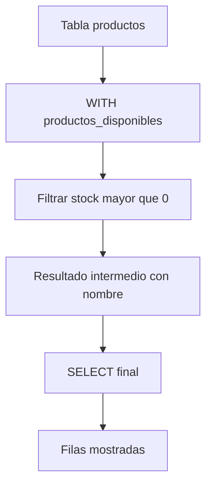
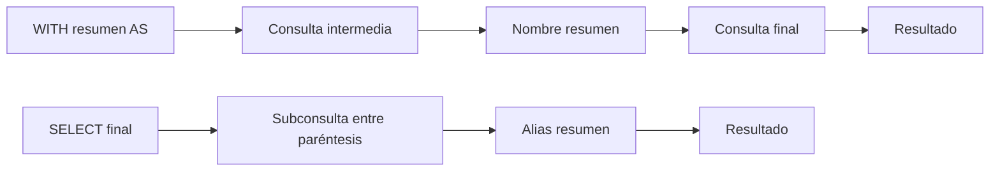
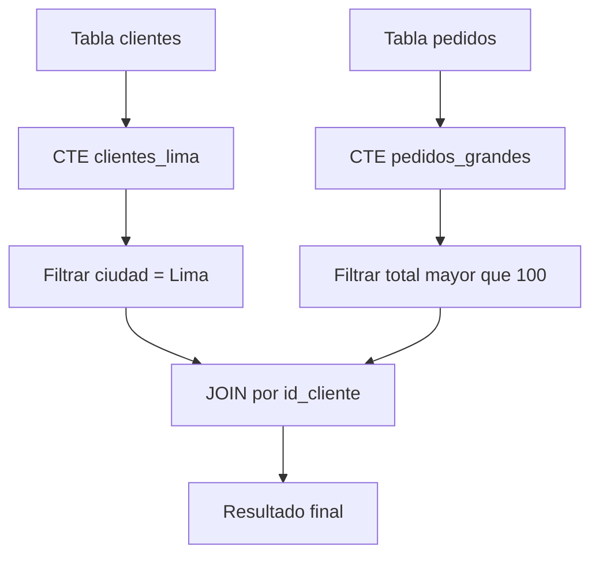
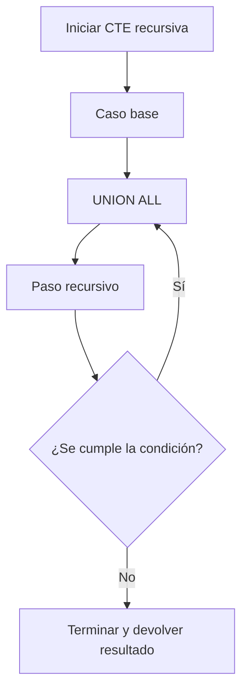
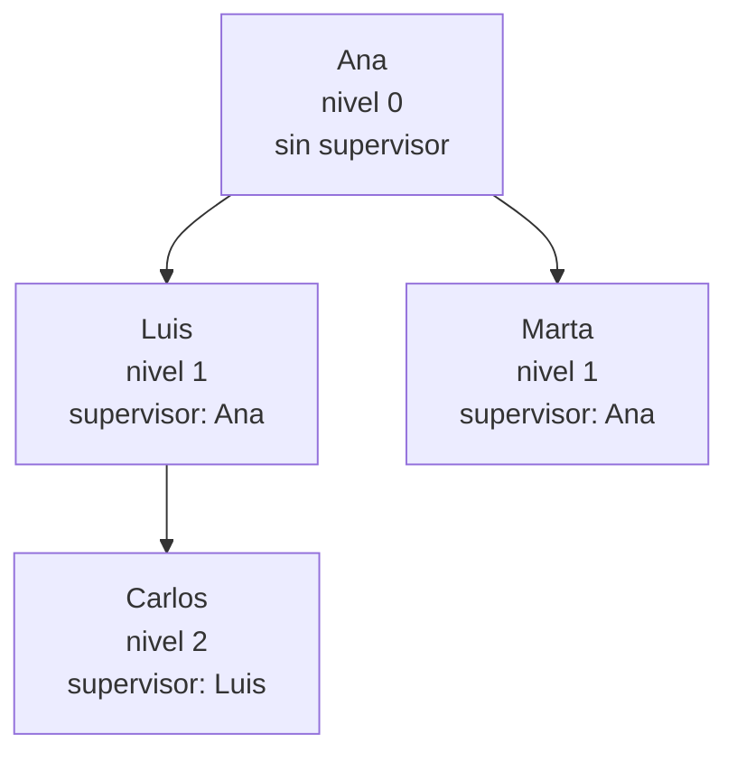
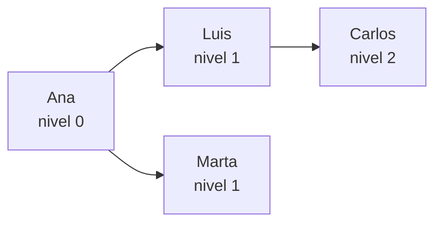
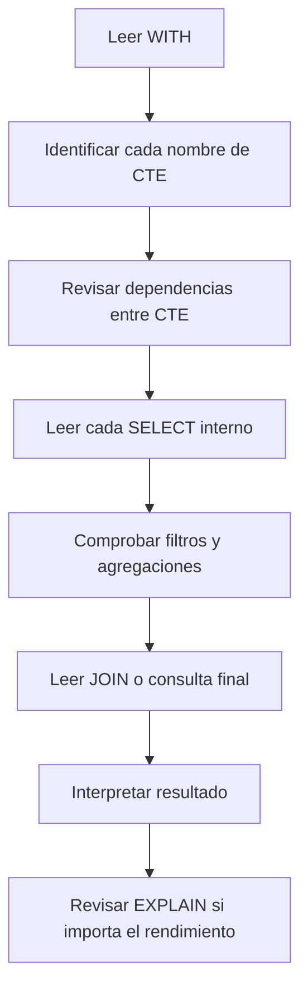

# CTE y `WITH` en SQL

Una **CTE** (*Common Table Expression*) es una expresión de tabla común que permite nombrar un resultado intermedio dentro de una consulta.

Se define al comienzo de la instrucción utilizando `WITH` y luego se consulta como si fuera una tabla temporal disponible durante esa sentencia.

```sql
WITH nombre_cte AS (
    SELECT columnas
    FROM tabla
    WHERE condicion
)
SELECT columnas
FROM nombre_cte;
```

> **Idea central.** Una CTE divide una consulta compleja en pasos con nombre, haciendo que la lógica sea más fácil de leer, probar y mantener.

---

## 1. Tablas de ejemplo

Usaremos las tablas `clientes`, `pedidos` y `productos`.

### `clientes`

```sql
CREATE TABLE clientes (
    id_cliente INT PRIMARY KEY,
    nombre VARCHAR(100) NOT NULL,
    ciudad VARCHAR(80)
);
```

```sql
INSERT INTO clientes (id_cliente, nombre, ciudad)
VALUES
    (101, 'Ana', 'Lima'),
    (102, 'Luis', 'Cusco'),
    (103, 'Marta', 'Lima'),
    (104, 'Carlos', 'Arequipa');
```

| id_cliente | nombre | ciudad |
| ---: | :--- | :--- |
| 101 | Ana | Lima |
| 102 | Luis | Cusco |
| 103 | Marta | Lima |
| 104 | Carlos | Arequipa |

### `pedidos`

```sql
CREATE TABLE pedidos (
    id_pedido INT PRIMARY KEY,
    id_cliente INT,
    fecha_pedido DATE,
    total DECIMAL(10,2)
);
```

```sql
INSERT INTO pedidos (id_pedido, id_cliente, fecha_pedido, total)
VALUES
    (1001, 101, '2026-10-01', 149.90),
    (1002, 102, '2026-10-02', 79.90),
    (1003, 101, '2026-10-05', 899.00),
    (1004, 103, '2026-10-08', 45.00);
```

| id_pedido | id_cliente | fecha_pedido | total |
| ---: | ---: | :--- | ---: |
| 1001 | 101 | 2026-10-01 | 149.90 |
| 1002 | 102 | 2026-10-02 | 79.90 |
| 1003 | 101 | 2026-10-05 | 899.00 |
| 1004 | 103 | 2026-10-08 | 45.00 |

### `productos`

```sql
CREATE TABLE productos (
    id_producto INT PRIMARY KEY,
    nombre VARCHAR(100) NOT NULL,
    categoria VARCHAR(50),
    precio DECIMAL(10,2),
    stock INT
);
```

```sql
INSERT INTO productos (id_producto, nombre, categoria, precio, stock)
VALUES
    (1, 'Teclado mecánico', 'periféricos', 149.90, 12),
    (2, 'Mouse inalámbrico', 'periféricos', 79.90, 25),
    (3, 'Monitor 24 pulgadas', 'monitores', 899.00, 8),
    (4, 'Webcam HD', 'cámaras', 219.50, 0),
    (5, 'Alfombrilla grande', 'periféricos', 45.00, 40);
```

---

## 2. Estructura básica de una CTE

```sql
WITH productos_disponibles AS (
    SELECT
        id_producto,
        nombre,
        precio,
        stock
    FROM productos
    WHERE stock > 0
)
SELECT nombre, precio, stock
FROM productos_disponibles;
```

### Resultado

| nombre | precio | stock |
| :--- | ---: | ---: |
| Teclado mecánico | 149.90 | 12 |
| Mouse inalámbrico | 79.90 | 25 |
| Monitor 24 pulgadas | 899.00 | 8 |
| Alfombrilla grande | 45.00 | 40 |

### Partes principales

| Parte | Función |
| :--- | :--- |
| `WITH` | Inicia la definición de las CTE |
| `productos_disponibles` | Nombre de la CTE |
| `AS (...)` | Consulta que construye el resultado intermedio |
| Consulta final | Utiliza la CTE como si fuera una tabla |

Una CTE solo existe durante la ejecución de esa instrucción. No crea una tabla permanente.

### Flujo de lectura de una CTE



La lectura conceptual sigue este orden: se toma la tabla de origen, se construye el resultado de la CTE y después la consulta final utiliza ese resultado.

> **Qué debes recordar.** El nombre de una CTE representa el resultado de la consulta que aparece entre paréntesis.

---

## 3. CTE frente a subconsulta en `FROM`

Una CTE y una tabla derivada pueden expresar una lógica similar.

### Tabla derivada

```sql
SELECT resumen.ciudad, resumen.total_clientes
FROM (
    SELECT
        ciudad,
        COUNT(*) AS total_clientes
    FROM clientes
    GROUP BY ciudad
) AS resumen
WHERE resumen.total_clientes > 1;
```

### CTE

```sql
WITH resumen AS (
    SELECT
        ciudad,
        COUNT(*) AS total_clientes
    FROM clientes
    GROUP BY ciudad
)
SELECT ciudad, total_clientes
FROM resumen
WHERE total_clientes > 1;
```

### Resultado

| ciudad | total_clientes |
| :--- | ---: |
| Lima | 2 |

| Característica | CTE | Subconsulta en `FROM` |
| :--- | :--- | :--- |
| Nombre propio | Sí | Alias de tabla derivada |
| Lectura | Suele ser más clara | Puede anidarse visualmente |
| Reutilización en la misma consulta | Sí, según el motor | No suele ser tan directa |
| Existencia permanente | No | No |
| Uso recursivo | Sí, con `WITH RECURSIVE` | No de forma natural |

### Orden de lectura: CTE frente a subconsulta



La CTE se lee de arriba hacia abajo con un nombre visible. La subconsulta en `FROM` se lee dentro de la consulta externa y suele requerir seguir más niveles de paréntesis.

---

## 4. CTE con filtro y cálculo

Una CTE puede preparar un conjunto de datos y la consulta final puede calcular información sobre él.

```sql
WITH productos_caros AS (
    SELECT
        nombre,
        precio
    FROM productos
    WHERE precio > 100
)
SELECT
    nombre,
    precio,
    ROUND(precio * 1.18, 2) AS precio_con_impuesto
FROM productos_caros;
```

### Resultado

| nombre | precio | precio_con_impuesto |
| :--- | ---: | ---: |
| Teclado mecánico | 149.90 | 176.88 |
| Monitor 24 pulgadas | 899.00 | 1060.82 |
| Webcam HD | 219.50 | 259.01 |

Separar el filtro del cálculo hace que cada paso tenga una responsabilidad clara.

---

## 5. Varias CTE en una misma consulta

Cuando se definen varias CTE, se separan con comas.

```sql
WITH clientes_lima AS (
    SELECT id_cliente, nombre
    FROM clientes
    WHERE ciudad = 'Lima'
), pedidos_grandes AS (
    SELECT id_cliente, id_pedido, total
    FROM pedidos
    WHERE total > 100
)
SELECT
    c.nombre,
    p.id_pedido,
    p.total
FROM clientes_lima AS c
JOIN pedidos_grandes AS p
    ON p.id_cliente = c.id_cliente;
```

### Resultado

| nombre | id_pedido | total |
| :--- | ---: | ---: |
| Ana | 1001 | 149.90 |
| Ana | 1003 | 899.00 |

### Flujo de la consulta



El flujo se lee desde las tablas originales hacia cada CTE y luego hacia el `JOIN` final. Las dos ramas se pueden preparar de forma independiente antes de combinarse.

> **Regla práctica.** Ordena las CTE desde los datos más básicos hasta los resultados derivados que dependen de ellas.

---

## 5.1 Una CTE basada en otra CTE

```sql
WITH pedidos_validos AS (
    SELECT id_pedido, id_cliente, total
    FROM pedidos
    WHERE total > 0
), resumen_clientes AS (
    SELECT
        id_cliente,
        COUNT(*) AS cantidad_pedidos,
        SUM(total) AS total_comprado
    FROM pedidos_validos
    GROUP BY id_cliente
)
SELECT *
FROM resumen_clientes
WHERE total_comprado > 100;
```

### Resultado

| id_cliente | cantidad_pedidos | total_comprado |
| ---: | ---: | ---: |
| 101 | 2 | 1048.90 |

La segunda CTE reutiliza el resultado filtrado de la primera.

### Dependencia entre CTE


Aquí la lectura es secuencial: `pedidos_validos` se construye primero, `resumen_clientes` depende de ella y la consulta final depende del resumen.

---

## 6. CTE con `JOIN`

Las CTE son especialmente útiles para preparar datos antes de combinarlos.

```sql
WITH resumen_pedidos AS (
    SELECT
        id_cliente,
        COUNT(*) AS cantidad_pedidos,
        SUM(total) AS total_comprado
    FROM pedidos
    GROUP BY id_cliente
)
SELECT
    c.nombre,
    COALESCE(r.cantidad_pedidos, 0) AS cantidad_pedidos,
    COALESCE(r.total_comprado, 0) AS total_comprado
FROM clientes AS c
LEFT JOIN resumen_pedidos AS r
    ON r.id_cliente = c.id_cliente;
```

### Resultado

| nombre | cantidad_pedidos | total_comprado |
| :--- | ---: | ---: |
| Ana | 2 | 1048.90 |
| Luis | 1 | 79.90 |
| Marta | 1 | 45.00 |
| Carlos | 0 | 0.00 |

### Ventaja del `LEFT JOIN`

Carlos aparece aunque no exista en `resumen_pedidos`, porque se conservan todas las filas de `clientes`.

---

## 7. CTE con `GROUP BY` y `HAVING`

```sql
WITH resumen AS (
    SELECT
        id_cliente,
        COUNT(*) AS cantidad_pedidos,
        SUM(total) AS total_comprado
    FROM pedidos
    GROUP BY id_cliente
    HAVING SUM(total) > 100
)
SELECT
    c.nombre,
    r.cantidad_pedidos,
    r.total_comprado
FROM resumen AS r
JOIN clientes AS c
    ON c.id_cliente = r.id_cliente;
```

### Resultado

| nombre | cantidad_pedidos | total_comprado |
| :--- | ---: | ---: |
| Ana | 2 | 1048.90 |

La CTE puede dejar preparado el resultado agrupado y la consulta final puede añadir información descriptiva de otra tabla.

---

## 8. CTE y `CASE`

```sql
WITH resumen_stock AS (
    SELECT
        nombre,
        stock
    FROM productos
)
SELECT
    nombre,
    stock,
    CASE
        WHEN stock = 0 THEN 'Agotado'
        WHEN stock < 10 THEN 'Poco stock'
        ELSE 'Disponible'
    END AS estado_stock
FROM resumen_stock;
```

### Resultado

| nombre | stock | estado_stock |
| :--- | ---: | :--- |
| Teclado mecánico | 12 | Disponible |
| Mouse inalámbrico | 25 | Disponible |
| Monitor 24 pulgadas | 8 | Poco stock |
| Webcam HD | 0 | Agotado |
| Alfombrilla grande | 40 | Disponible |

También se puede crear la clasificación dentro de la CTE y reutilizarla después.

```sql
WITH productos_clasificados AS (
    SELECT
        nombre,
        precio,
        CASE
            WHEN precio < 100 THEN 'Económico'
            WHEN precio <= 300 THEN 'Intermedio'
            ELSE 'Premium'
        END AS segmento
    FROM productos
)
SELECT segmento, COUNT(*) AS cantidad
FROM productos_clasificados
GROUP BY segmento;
```

---

## 9. CTE para encontrar máximos y mínimos

## 9.1 Producto más caro

```sql
WITH precio_maximo AS (
    SELECT MAX(precio) AS maximo
    FROM productos
)
SELECT p.nombre, p.precio
FROM productos AS p
CROSS JOIN precio_maximo AS m
WHERE p.precio = m.maximo;
```

| nombre | precio |
| :--- | ---: |
| Monitor 24 pulgadas | 899.00 |

## 9.2 Cliente con mayor total comprado

```sql
WITH totales AS (
    SELECT
        id_cliente,
        SUM(total) AS total_comprado
    FROM pedidos
    GROUP BY id_cliente
), maximo AS (
    SELECT MAX(total_comprado) AS valor
    FROM totales
)
SELECT
    c.nombre,
    t.total_comprado
FROM totales AS t
JOIN maximo AS m
    ON t.total_comprado = m.valor
JOIN clientes AS c
    ON c.id_cliente = t.id_cliente;
```

| nombre | total_comprado |
| :--- | ---: |
| Ana | 1048.90 |

> **Ventaja.** Esta forma conserva empates: si dos clientes tienen el mismo máximo, ambos aparecerán.

---

## 10. CTE recursiva

Una CTE recursiva se referencia a sí misma. Se utiliza para trabajar con jerarquías, árboles, categorías anidadas o secuencias.

La estructura general es:

```sql
WITH RECURSIVE nombre_cte AS (
    -- Caso base
    SELECT ...

    UNION ALL

    -- Paso recursivo
    SELECT ...
    FROM nombre_cte
    WHERE condicion_de_parada
)
SELECT *
FROM nombre_cte;
```

Una CTE recursiva tiene dos partes:

| Parte | Función |
| :--- | :--- |
| Caso base | Define las filas iniciales |
| Paso recursivo | Obtiene las filas siguientes |
| `UNION ALL` | Combina ambos resultados |
| Condición de parada | Evita una recursión infinita |

### Flujo de una CTE recursiva



A diferencia de una CTE normal, la rama recursiva vuelve a utilizar el nombre de la propia CTE. El ciclo solo debe continuar mientras la condición de parada se cumpla.

---

## 10.1 Generar una secuencia de números

```sql
WITH RECURSIVE numeros AS (
    SELECT 1 AS n

    UNION ALL

    SELECT n + 1
    FROM numeros
    WHERE n < 5
)
SELECT n
FROM numeros;
```

### Resultado

| n |
| ---: |
| 1 |
| 2 |
| 3 |
| 4 |
| 5 |

### Cómo funciona

| Iteración | Valor generado |
| ---: | ---: |
| Caso base | 1 |
| 1 | 2 |
| 2 | 3 |
| 3 | 4 |
| 4 | 5 |
| Fin | `n < 5` ya no se cumple |

> **Advertencia.** Una CTE recursiva sin condición de parada puede producir una ejecución infinita o alcanzar el límite de recursión del motor.

## 10.2 Jerarquía de empleados

```sql
CREATE TABLE empleados (
    id_empleado INT PRIMARY KEY,
    nombre VARCHAR(100),
    id_supervisor INT
);
```

```sql
INSERT INTO empleados (id_empleado, nombre, id_supervisor)
VALUES
    (1, 'Ana', NULL),
    (2, 'Luis', 1),
    (3, 'Marta', 1),
    (4, 'Carlos', 2);
```

```sql
WITH RECURSIVE jerarquia AS (
    SELECT
        id_empleado,
        nombre,
        id_supervisor,
        0 AS nivel
    FROM empleados
    WHERE id_supervisor IS NULL

    UNION ALL

    SELECT
        e.id_empleado,
        e.nombre,
        e.id_supervisor,
        j.nivel + 1
    FROM empleados AS e
    JOIN jerarquia AS j
        ON e.id_supervisor = j.id_empleado
)
SELECT id_empleado, nombre, id_supervisor, nivel
FROM jerarquia
ORDER BY nivel, id_empleado;
```

### Resultado

| id_empleado | nombre | id_supervisor | nivel |
| ---: | :--- | ---: | ---: |
| 1 | Ana | `NULL` | 0 |
| 2 | Luis | 1 | 1 |
| 3 | Marta | 1 | 1 |
| 4 | Carlos | 2 | 2 |

### Flujo de lectura de la jerarquía



La CTE comienza con Ana, que no tiene supervisor. Después busca empleados cuyo `id_supervisor` coincida con un empleado ya encontrado y aumenta el nivel en cada recorrido.

### Lectura de niveles



La lectura se realiza desde arriba hacia abajo: Ana es el punto de partida; Luis y Marta dependen directamente de Ana; y Carlos depende de Luis.

> **Compatibilidad.** La sintaxis exacta de las CTE recursivas puede variar. Verifica si tu SGBD requiere `WITH RECURSIVE` o utiliza otra forma.

---

## 11. Variantes y opciones de materialización

Algunos motores permiten indicar si una CTE debe materializarse o ser expandida por el optimizador.

```sql
WITH datos AS MATERIALIZED (
    SELECT *
    FROM pedidos
)
SELECT *
FROM datos;
```

O:

```sql
WITH datos AS NOT MATERIALIZED (
    SELECT *
    FROM pedidos
)
SELECT *
FROM datos;
```

| Concepto | Explicación |
| :--- | :--- |
| Materializar | Construir y conservar temporalmente el resultado intermedio |
| No materializar | Permitir que el optimizador integre la CTE en la consulta |
| Comportamiento por defecto | Depende del motor y de la versión |

> **Nota.** No uses estas opciones sin revisar la documentación del SGBD. En muchos casos el optimizador decide automáticamente la estrategia más conveniente.

---

## 12. CTE con `INSERT`, `UPDATE` y `DELETE`

Una CTE no se limita a `SELECT`.

## 12.1 CTE con `INSERT`

```sql
WITH clientes_lima AS (
    SELECT id_cliente, nombre
    FROM clientes
    WHERE ciudad = 'Lima'
)
INSERT INTO clientes_resumen (id_cliente, nombre)
SELECT id_cliente, nombre
FROM clientes_lima;
```

## 12.2 CTE con `UPDATE`

```sql
WITH precios_actualizados AS (
    SELECT
        id_producto,
        ROUND(precio * 1.10, 2) AS nuevo_precio
    FROM productos
    WHERE categoria = 'periféricos'
)
UPDATE productos AS p
JOIN precios_actualizados AS a
    ON a.id_producto = p.id_producto
SET p.precio = a.nuevo_precio;
```

La sintaxis de `UPDATE` con CTE cambia según el motor.

## 12.3 CTE con `DELETE`

```sql
WITH clientes_sin_pedidos AS (
    SELECT c.id_cliente
    FROM clientes AS c
    WHERE NOT EXISTS (
        SELECT 1
        FROM pedidos AS p
        WHERE p.id_cliente = c.id_cliente
    )
)
DELETE FROM clientes
WHERE id_cliente IN (
    SELECT id_cliente
    FROM clientes_sin_pedidos
);
```

> **Precaución.** Prueba siempre la CTE con un `SELECT` antes de modificar o eliminar datos.

---

## 13. CTE frente a tabla temporal

Una CTE y una tabla temporal resuelven necesidades diferentes.

| Característica | CTE | Tabla temporal |
| :--- | :--- | :--- |
| Duración | Una sola sentencia | Puede durar toda la sesión o transacción |
| Creación | Parte de la consulta | Se crea con una instrucción propia |
| Reutilización | Durante esa sentencia | En varias consultas |
| Índices propios | Generalmente no directamente | Puede tener índices |
| Recursión | Sí, con sintaxis recursiva | No automáticamente |
| Persistencia | No permanente | Temporal, según el motor |
| Lectura | Buena para pasos lógicos | Buena para procesos por etapas |

### CTE

```sql
WITH resumen AS (
    SELECT id_cliente, SUM(total) AS total_comprado
    FROM pedidos
    GROUP BY id_cliente
)
SELECT *
FROM resumen;
```

### Tabla temporal

```sql
CREATE TEMPORARY TABLE resumen AS
SELECT id_cliente, SUM(total) AS total_comprado
FROM pedidos
GROUP BY id_cliente;

SELECT *
FROM resumen;
```

> **Regla práctica.** Usa CTE para organizar una consulta; usa una tabla temporal cuando necesites reutilizar el resultado en varias sentencias o crear índices intermedios.

---

## 14. CTE frente a vista

| Característica | CTE | Vista |
| :--- | :--- | :--- |
| Duración | Una sentencia | Persistente hasta eliminarla |
| Uso | Consulta puntual | Consulta reutilizable |
| Definición | Dentro de la instrucción | `CREATE VIEW` |
| Compartida por usuarios | No | Sí, según permisos |
| Ideal para | Descomponer lógica | Abstraer una consulta estable |

### Vista

```sql
CREATE VIEW resumen_pedidos AS
SELECT
    id_cliente,
    COUNT(*) AS cantidad_pedidos,
    SUM(total) AS total_comprado
FROM pedidos
GROUP BY id_cliente;
```

### CTE

```sql
WITH resumen_pedidos AS (
    SELECT
        id_cliente,
        COUNT(*) AS cantidad_pedidos,
        SUM(total) AS total_comprado
    FROM pedidos
    GROUP BY id_cliente
)
SELECT *
FROM resumen_pedidos;
```

---

## 15. CTE y orden de evaluación

Una CTE se escribe antes del `SELECT`, pero eso no significa que siempre se materialice físicamente antes de todo lo demás.

```sql
WITH pedidos_grandes AS (
    SELECT *
    FROM pedidos
    WHERE total > 100
)
SELECT COUNT(*)
FROM pedidos_grandes;
```

Lógicamente se puede leer así:

1. Definir `pedidos_grandes`.
2. Consultar esa relación.
3. Contar sus filas.

Físicamente, el optimizador puede transformar el plan. Para saber qué ocurre, utiliza `EXPLAIN`.

---

## 16. Optimización y buenas prácticas

### Diagrama general para leer una consulta con CTE



Este orden ayuda a estudiar una consulta larga: primero se identifican las etapas, luego se revisa qué datos produce cada una y finalmente se analiza cómo se combinan.


| Buena práctica | Motivo |
| :--- | :--- |
| Dar nombres descriptivos | Facilita leer el flujo de la consulta |
| Una responsabilidad por CTE | Evita bloques difíciles de comprender |
| Seleccionar solo columnas necesarias | Reduce datos intermedios |
| Filtrar temprano | Puede disminuir el costo de joins y agregaciones |
| Probar cada CTE por separado | Ayuda a detectar errores |
| Evitar CTE innecesarias | No todo requiere dividirse |
| Revisar índices en columnas de join | Mejora el acceso a datos |
| Usar `EXPLAIN` | Permite comprobar el plan real |
| Controlar la recursión | Evita ciclos o resultados infinitos |
| Documentar CTE complejas | Facilita mantenimiento futuro |

### Ejemplo de nombres claros

```sql
WITH pedidos_del_mes AS (
    SELECT *
    FROM pedidos
    WHERE fecha_pedido >= '2026-10-01'
), resumen_por_cliente AS (
    SELECT
        id_cliente,
        SUM(total) AS total_comprado
    FROM pedidos_del_mes
    GROUP BY id_cliente
)
SELECT *
FROM resumen_por_cliente;
```

Nombres como `pedidos_del_mes` y `resumen_por_cliente` explican el propósito de cada etapa.

---

## 17. Errores comunes

| Error | Qué ocurre | Cómo evitarlo |
| :--- | :--- | :--- |
| Olvidar `WITH` | La CTE no se puede declarar | Iniciar la sentencia con `WITH` |
| Olvidar el alias en una tabla derivada | El motor puede rechazar la consulta | Nombrar la CTE y sus tablas derivadas |
| Separar CTE con `;` | Se termina la instrucción antes de tiempo | Usar comas entre CTE |
| Referenciar una CTE antes de definirla | El nombre todavía no existe | Definirlas en orden de dependencia |
| Confundir CTE con tabla permanente | Se espera que exista después de la consulta | Recordar que dura una sola sentencia |
| Recursión sin caso base | No hay punto de inicio | Definir claramente el caso base |
| Recursión sin condición de parada | Puede producir un ciclo infinito | Establecer un límite o condición |
| Usar `UNION` cuando se necesita repetir niveles | Elimina duplicados de forma innecesaria | Preferir `UNION ALL` en recursión, según el caso |
| Pensar que una CTE siempre mejora el rendimiento | Puede no cambiar o incluso empeorar el plan | Verificar con `EXPLAIN` |
| Cambiar datos sin probar | `UPDATE` o `DELETE` pueden afectar muchas filas | Ejecutar primero un `SELECT` |
| Usar demasiadas CTE pequeñas | La consulta se fragmenta demasiado | Dividir solo cuando aporte claridad |

### Ejemplo incorrecto y corregido

```sql
-- Incorrecto: punto y coma termina la sentencia
WITH clientes_lima AS (
    SELECT * FROM clientes
);
SELECT * FROM clientes_lima;
```

```sql
-- Correcto: la consulta final pertenece a la misma sentencia
WITH clientes_lima AS (
    SELECT * FROM clientes
)
SELECT *
FROM clientes_lima;
```

---

## 18. Práctica guiada

## Pregunta 1: filtrar mediante una CTE

Muestra los productos que tienen stock disponible.

<details>
<summary>Ver respuesta</summary>

```sql
WITH disponibles AS (
    SELECT *
    FROM productos
    WHERE stock > 0
)
SELECT *
FROM disponibles;
```

</details>

## Pregunta 2: resumen por cliente

Calcula el total comprado por cada cliente usando una CTE.

<details>
<summary>Ver respuesta</summary>

```sql
WITH totales AS (
    SELECT
        id_cliente,
        SUM(total) AS total_comprado
    FROM pedidos
    GROUP BY id_cliente
)
SELECT *
FROM totales;
```

</details>

## Pregunta 3: unir una CTE con otra tabla

Muestra el nombre del cliente junto con su total comprado.

<details>
<summary>Ver respuesta</summary>

```sql
WITH totales AS (
    SELECT
        id_cliente,
        SUM(total) AS total_comprado
    FROM pedidos
    GROUP BY id_cliente
)
SELECT
    c.nombre,
    t.total_comprado
FROM clientes AS c
JOIN totales AS t
    ON t.id_cliente = c.id_cliente;
```

</details>

## Pregunta 4: CTE recursiva

Genera los números del 1 al 5.

<details>
<summary>Ver respuesta</summary>

```sql
WITH RECURSIVE numeros AS (
    SELECT 1 AS n
    UNION ALL
    SELECT n + 1
    FROM numeros
    WHERE n < 5
)
SELECT n
FROM numeros;
```

</details>

## Pregunta 5: separar dos etapas

Obtén las ciudades con más de un cliente mediante dos pasos lógicos.

<details>
<summary>Ver respuesta</summary>

```sql
WITH cantidad_por_ciudad AS (
    SELECT
        ciudad,
        COUNT(*) AS cantidad
    FROM clientes
    GROUP BY ciudad
)
SELECT ciudad, cantidad
FROM cantidad_por_ciudad
WHERE cantidad > 1;
```

</details>

---

## 19. Mini desafío final

Usa las tablas de ejemplo para resolver:

1. Crear una CTE con los pedidos mayores a 100.
2. Calcular el total comprado por cliente a partir de esa CTE.
3. Mostrar el nombre de cada cliente y su total, incluyendo quienes no tengan pedidos grandes.
4. Crear una CTE que clasifique los productos según su stock.
5. Encontrar el cliente con mayor total comprado.
6. Generar una secuencia del 1 al 10 con una CTE recursiva.
7. Representar la jerarquía de empleados con una CTE recursiva.

## Una solución posible

```sql
-- 1 y 2. Filtrar pedidos y resumir por cliente
WITH pedidos_grandes AS (
    SELECT id_cliente, total
    FROM pedidos
    WHERE total > 100
), totales AS (
    SELECT
        id_cliente,
        SUM(total) AS total_grande
    FROM pedidos_grandes
    GROUP BY id_cliente
)
SELECT *
FROM totales;

-- 3. Incluir clientes sin pedidos grandes
WITH pedidos_grandes AS (
    SELECT id_cliente, total
    FROM pedidos
    WHERE total > 100
), totales AS (
    SELECT
        id_cliente,
        SUM(total) AS total_grande
    FROM pedidos_grandes
    GROUP BY id_cliente
)
SELECT
    c.nombre,
    COALESCE(t.total_grande, 0) AS total_grande
FROM clientes AS c
LEFT JOIN totales AS t
    ON t.id_cliente = c.id_cliente;

-- 4. Clasificar productos
WITH productos_clasificados AS (
    SELECT
        nombre,
        stock,
        CASE
            WHEN stock = 0 THEN 'Agotado'
            WHEN stock < 10 THEN 'Poco stock'
            ELSE 'Disponible'
        END AS estado
    FROM productos
)
SELECT *
FROM productos_clasificados;

-- 5. Cliente con mayor total
WITH totales AS (
    SELECT id_cliente, SUM(total) AS total_comprado
    FROM pedidos
    GROUP BY id_cliente
), mayor AS (
    SELECT MAX(total_comprado) AS maximo
    FROM totales
)
SELECT c.nombre, t.total_comprado
FROM totales AS t
JOIN mayor AS m
    ON t.total_comprado = m.maximo
JOIN clientes AS c
    ON c.id_cliente = t.id_cliente;

-- 6. Secuencia del 1 al 10
WITH RECURSIVE numeros AS (
    SELECT 1 AS n
    UNION ALL
    SELECT n + 1
    FROM numeros
    WHERE n < 10
)
SELECT n
FROM numeros;
```

### Tabla de decisión

| Necesidad | Técnica recomendada |
| :--- | :--- |
| Nombrar un resultado intermedio | CTE simple |
| Usar varias etapas | Varias CTE |
| Reutilizar una CTE en el mismo statement | Referenciar su nombre |
| Recorrer una jerarquía | `WITH RECURSIVE` |
| Reutilizar en varias sentencias | Tabla temporal o vista |
| Crear una consulta persistente | Vista |
| Mejorar legibilidad frente a subconsulta anidada | CTE |

---

## 20. Resumen final

- Una CTE es un resultado intermedio con nombre definido mediante `WITH`.
- Solo existe durante la ejecución de la sentencia que la contiene.
- Puede utilizarse como si fuera una tabla.
- Varias CTE se separan con comas.
- Una CTE puede depender de otra definida anteriormente.
- `WITH RECURSIVE` permite trabajar con secuencias y jerarquías.
- El caso base inicia una CTE recursiva.
- El paso recursivo genera nuevas filas.
- Una condición de parada evita la recursión infinita.
- Las CTE pueden utilizarse con `SELECT`, `INSERT`, `UPDATE` y `DELETE`, según el motor.
- Son una alternativa legible a subconsultas anidadas.
- No son equivalentes a una tabla temporal ni a una vista persistente.
- Una CTE no garantiza por sí sola un mejor rendimiento.
- `EXPLAIN` permite revisar el plan real de ejecución.
- Los nombres descriptivos y la división por etapas facilitan el mantenimiento.

> **Qué debes recordar.** Una CTE sirve para organizar una consulta compleja en pasos claros y nombrados, sin crear una tabla permanente.

---

## Relacionado con otros temas

- [Subconsultas](subqueries.md): las CTE ofrecen una alternativa más legible para consultas anidadas.
- [JOIN](joins.md): las CTE suelen preparar datos antes de combinarlos.
- [Álgebra relacional](algebra-relacional.md): ayuda a entender las operaciones realizadas por cada etapa.
- [`SELECT` y `FROM`](../02-consultas-basicas/select-from.md): estructura de las consultas dentro de una CTE.
- [WHERE y operadores](../02-consultas-basicas/where-operadores.md): permite filtrar cada resultado intermedio.
- [Funciones SQL](../02-consultas-basicas/funciones-sql.md): se utilizan dentro de las CTE para calcular valores.
- [CASE y WHEN](../02-consultas-basicas/case-when.md): permite clasificar los datos preparados.
- [Agregaciones y `GROUP BY`](agregaciones-group-by.md): suele formar parte de las CTE de resumen.
- [Índices básicos](../06-indices-performance/indices-basicos.md): ayuda a mejorar consultas que combinan CTE y joins.
