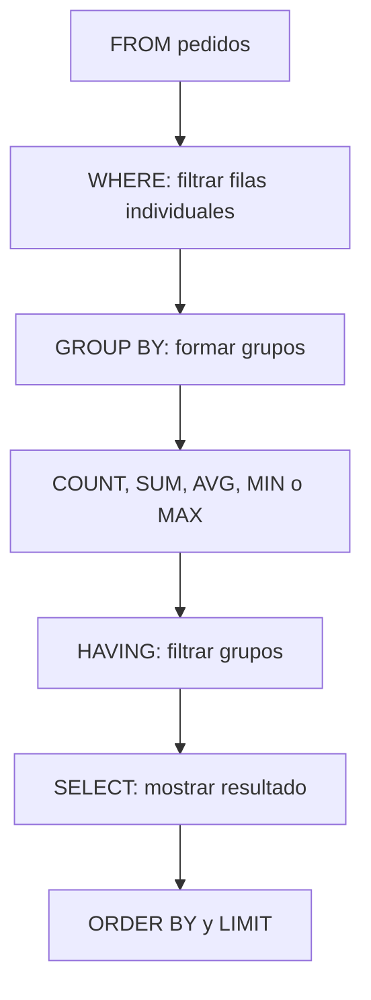
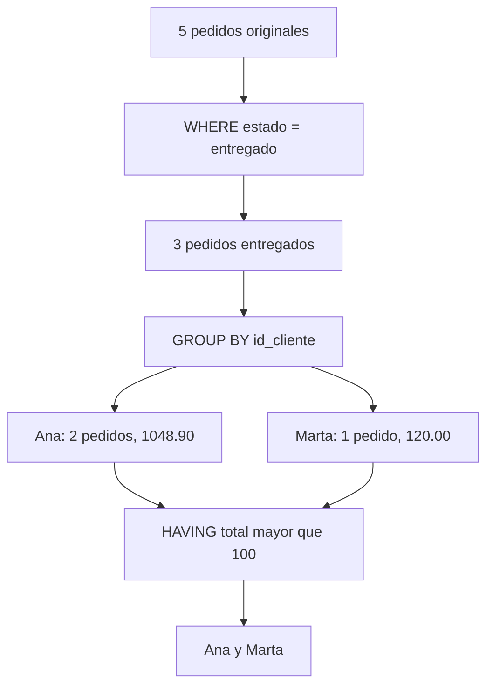

# Cláusula `HAVING`

`HAVING` permite filtrar grupos después de aplicar `GROUP BY` y funciones de agregación.

Mientras `WHERE` filtra filas individuales, `HAVING` filtra resultados agrupados.

```sql
SELECT columna_grupo, FUNCION_AGREGADA(columna)
FROM tabla
WHERE condicion_de_fila
GROUP BY columna_grupo
HAVING condicion_de_grupo;
```

> **Idea central.** `WHERE` decide qué filas entran al agrupamiento; `HAVING` decide qué grupos permanecen después de calcular los agregados.

---

## 1. Tablas de ejemplo

Usaremos las tablas `clientes` y `pedidos`.

### `clientes`

```sql
CREATE TABLE clientes (
    id_cliente INT PRIMARY KEY,
    nombre VARCHAR(100) NOT NULL,
    ciudad VARCHAR(80)
);
```

```sql
INSERT INTO clientes (id_cliente, nombre, ciudad)
VALUES
    (101, 'Ana', 'Lima'),
    (102, 'Luis', 'Cusco'),
    (103, 'Marta', 'Lima'),
    (104, 'Carlos', 'Arequipa');
```

| id_cliente | nombre | ciudad |
| ---: | :--- | :--- |
| 101 | Ana | Lima |
| 102 | Luis | Cusco |
| 103 | Marta | Lima |
| 104 | Carlos | Arequipa |

### `pedidos`

```sql
CREATE TABLE pedidos (
    id_pedido INT PRIMARY KEY,
    id_cliente INT,
    fecha_pedido DATE,
    estado VARCHAR(30),
    total DECIMAL(10,2)
);
```

```sql
INSERT INTO pedidos
    (id_pedido, id_cliente, fecha_pedido, estado, total)
VALUES
    (1001, 101, '2026-10-01', 'entregado', 149.90),
    (1002, 102, '2026-10-02', 'pendiente', 79.90),
    (1003, 101, '2026-10-05', 'entregado', 899.00),
    (1004, 103, '2026-10-08', 'cancelado', 45.00),
    (1005, 103, '2026-10-10', 'entregado', 120.00);
```

| id_pedido | id_cliente | fecha_pedido | estado | total |
| ---: | ---: | :--- | :--- | ---: |
| 1001 | 101 | 2026-10-01 | entregado | 149.90 |
| 1002 | 102 | 2026-10-02 | pendiente | 79.90 |
| 1003 | 101 | 2026-10-05 | entregado | 899.00 |
| 1004 | 103 | 2026-10-08 | cancelado | 45.00 |
| 1005 | 103 | 2026-10-10 | entregado | 120.00 |

---

## 2. Estructura básica de `HAVING`

```sql
SELECT
    id_cliente,
    COUNT(*) AS cantidad_pedidos
FROM pedidos
GROUP BY id_cliente
HAVING COUNT(*) >= 2;
```

### Resultado

| id_cliente | cantidad_pedidos |
| ---: | ---: |
| 101 | 2 |
| 103 | 2 |

Primero se forman los grupos por `id_cliente`; luego `HAVING` conserva únicamente los grupos con dos o más pedidos.

### Partes de la consulta

| Parte | Función |
| :--- | :--- |
| `GROUP BY id_cliente` | Forma un grupo por cliente |
| `COUNT(*)` | Cuenta los pedidos de cada grupo |
| `HAVING COUNT(*) >= 2` | Filtra los grupos resultantes |

---

## 3. Flujo de evaluación



### Lectura del flujo

1. Se obtienen las filas desde `FROM`.
2. `WHERE` elimina filas que no cumplen la condición.
3. `GROUP BY` forma los grupos.
4. Se calculan las funciones de agregación.
5. `HAVING` filtra los grupos completos.
6. `SELECT` construye las columnas del resultado.
7. `ORDER BY` y `LIMIT` organizan o limitan la salida.

> **Qué debes recordar.** `HAVING` necesita trabajar con grupos ya formados; por eso aparece después de `GROUP BY` en la consulta.

---

## 4. Diferencia entre `WHERE` y `HAVING`

### `WHERE`: filtrar filas

```sql
SELECT
    id_cliente,
    SUM(total) AS total_entregado
FROM pedidos
WHERE estado = 'entregado'
GROUP BY id_cliente;
```

| id_cliente | total_entregado |
| ---: | ---: |
| 101 | 1048.90 |
| 103 | 120.00 |

El pedido cancelado de Marta se elimina antes de sumar.

### `HAVING`: filtrar grupos

```sql
SELECT
    id_cliente,
    SUM(total) AS total_comprado
FROM pedidos
GROUP BY id_cliente
HAVING SUM(total) > 100;
```

| id_cliente | total_comprado |
| ---: | ---: |
| 101 | 1048.90 |
| 103 | 165.00 |

Aquí se suman todos los pedidos de cada cliente y luego se eliminan los grupos cuyo total no supera 100.

### Comparación

| Característica | `WHERE` | `HAVING` |
| :--- | :--- | :--- |
| Filtra | Filas | Grupos |
| Se aplica | Antes de `GROUP BY` | Después de `GROUP BY` |
| Uso principal | Condiciones sobre registros | Condiciones sobre agregados |
| Ejemplo | `total > 100` | `SUM(total) > 100` |
| Puede usar `COUNT` directamente | No | Sí |
| Puede aparecer sin agrupación | Sí | En algunos casos, sobre un único grupo |

---

## 5. Filtrar por cantidad de filas

```sql
SELECT
    id_cliente,
    COUNT(*) AS cantidad_pedidos
FROM pedidos
GROUP BY id_cliente
HAVING COUNT(*) > 1;
```

### Resultado

| id_cliente | cantidad_pedidos |
| ---: | ---: |
| 101 | 2 |
| 103 | 2 |

### Exactamente una cantidad

```sql
SELECT
    id_cliente,
    COUNT(*) AS cantidad_pedidos
FROM pedidos
GROUP BY id_cliente
HAVING COUNT(*) = 1;
```

| id_cliente | cantidad_pedidos |
| ---: | ---: |
| 102 | 1 |

---

## 6. Filtrar por suma

```sql
SELECT
    id_cliente,
    SUM(total) AS total_comprado
FROM pedidos
GROUP BY id_cliente
HAVING SUM(total) >= 200;
```

### Resultado

| id_cliente | total_comprado |
| ---: | ---: |
| 101 | 1048.90 |

La condición se aplica al total de cada grupo, no al total individual de cada pedido.

### Diferencia entre filtrar fila y grupo

```sql
-- Pedidos individuales mayores o iguales a 100
SELECT id_cliente, total
FROM pedidos
WHERE total >= 100;
```

```sql
-- Clientes cuya suma de pedidos es mayor o igual a 100
SELECT id_cliente, SUM(total) AS total_comprado
FROM pedidos
GROUP BY id_cliente
HAVING SUM(total) >= 100;
```

| Consulta | Unidad filtrada |
| :--- | :--- |
| `WHERE total >= 100` | Cada pedido |
| `HAVING SUM(total) >= 100` | Cada cliente agrupado |

---

## 7. Filtrar por promedio

```sql
SELECT
    id_cliente,
    AVG(total) AS promedio_pedido
FROM pedidos
GROUP BY id_cliente
HAVING AVG(total) > 100;
```

### Resultado

| id_cliente | promedio_pedido |
| ---: | ---: |
| 101 | 524.45 |
| 103 | 82.50 |

Solo Ana tiene un promedio superior a 100. Marta tiene dos pedidos, pero su promedio es 82.50.

> **Cuidado.** Un cliente puede tener una suma alta y un promedio bajo, o una suma baja y un promedio alto. Elige la función según la pregunta.

---

## 8. Filtrar por mínimo y máximo

```sql
SELECT
    id_cliente,
    MIN(total) AS pedido_minimo,
    MAX(total) AS pedido_maximo
FROM pedidos
GROUP BY id_cliente
HAVING MAX(total) > 500;
```

### Resultado

| id_cliente | pedido_minimo | pedido_maximo |
| ---: | ---: | ---: |
| 101 | 149.90 | 899.00 |

### Variaciones

```sql
-- Clientes cuyo pedido mínimo supera 50
HAVING MIN(total) > 50
```

```sql
-- Clientes con algún pedido superior a 500
HAVING MAX(total) > 500
```

| Expresión | Pregunta |
| :--- | :--- |
| `MIN(total) > 50` | ¿Todos los pedidos del grupo superan indirectamente ese límite? |
| `MAX(total) > 500` | ¿Existe al menos un pedido superior a 500? |
| `MAX(total) <= 500` | ¿Ningún pedido supera 500? |

---

## 9. `HAVING` con varias condiciones

```sql
SELECT
    id_cliente,
    COUNT(*) AS cantidad_pedidos,
    SUM(total) AS total_comprado
FROM pedidos
GROUP BY id_cliente
HAVING COUNT(*) >= 2
   AND SUM(total) > 200;
```

### Resultado

| id_cliente | cantidad_pedidos | total_comprado |
| ---: | ---: | ---: |
| 101 | 2 | 1048.90 |

### Evaluación por grupo

| id_cliente | `COUNT(*) >= 2` | `SUM(total) > 200` | ¿Pasa? |
| ---: | :---: | :---: | :---: |
| 101 | Sí | Sí | Sí |
| 102 | No | No | No |
| 103 | Sí | No | No |

---

## 10. `HAVING` con `OR`

```sql
SELECT
    id_cliente,
    COUNT(*) AS cantidad_pedidos,
    SUM(total) AS total_comprado
FROM pedidos
GROUP BY id_cliente
HAVING COUNT(*) >= 2
    OR SUM(total) > 500;
```

### Resultado

| id_cliente | cantidad_pedidos | total_comprado |
| ---: | ---: | ---: |
| 101 | 2 | 1048.90 |
| 103 | 2 | 165.00 |

Con `OR`, basta que una de las condiciones del grupo sea verdadera.

### Usar paréntesis

```sql
HAVING (
    COUNT(*) >= 2
    AND SUM(total) > 150
)
OR MAX(total) > 800
```

Los paréntesis hacen explícita la intención cuando se combinan `AND` y `OR`.

---

## 11. `WHERE` y `HAVING` en la misma consulta

Es común filtrar filas primero y grupos después.

```sql
SELECT
    id_cliente,
    COUNT(*) AS pedidos_validos,
    SUM(total) AS total_valido
FROM pedidos
WHERE estado = 'entregado'
GROUP BY id_cliente
HAVING SUM(total) > 100;
```

### Flujo detallado



### Resultado

| id_cliente | pedidos_validos | total_valido |
| ---: | ---: | ---: |
| 101 | 2 | 1048.90 |
| 103 | 1 | 120.00 |

El pedido cancelado de 45.00 no participa porque fue descartado por `WHERE` antes de calcular el total.

---

## 12. `HAVING` con `JOIN`

```sql
SELECT
    c.ciudad,
    COUNT(p.id_pedido) AS cantidad_pedidos,
    SUM(p.total) AS total_vendido
FROM clientes AS c
JOIN pedidos AS p
    ON p.id_cliente = c.id_cliente
GROUP BY c.ciudad
HAVING SUM(p.total) > 100;
```

### Resultado

| ciudad | cantidad_pedidos | total_vendido |
| :--- | ---: | ---: |
| Lima | 4 | 1213.90 |

Cusco suma 79.90 y no supera el límite. Arequipa no aparece porque el `INNER JOIN` no encuentra pedidos para Carlos.

### Incluir ciudades sin pedidos

```sql
SELECT
    c.ciudad,
    COUNT(p.id_pedido) AS cantidad_pedidos,
    COALESCE(SUM(p.total), 0) AS total_vendido
FROM clientes AS c
LEFT JOIN pedidos AS p
    ON p.id_cliente = c.id_cliente
GROUP BY c.ciudad
HAVING COALESCE(SUM(p.total), 0) >= 0;
```

| ciudad | cantidad_pedidos | total_vendido |
| :--- | ---: | ---: |
| Arequipa | 0 | 0.00 |
| Cusco | 1 | 79.90 |
| Lima | 4 | 1213.90 |

> **Importante.** Con `LEFT JOIN`, utiliza `COUNT(p.id_pedido)` para que un cliente sin pedidos cuente como cero y no como una fila artificial.

---

## 13. Agrupar por varias columnas y filtrar grupos

```sql
SELECT
    id_cliente,
    estado,
    COUNT(*) AS cantidad,
    SUM(total) AS total_estado
FROM pedidos
GROUP BY id_cliente, estado
HAVING SUM(total) > 100;
```

### Resultado

| id_cliente | estado | cantidad | total_estado |
| ---: | :--- | ---: | ---: |
| 101 | entregado | 2 | 1048.90 |
| 103 | entregado | 1 | 120.00 |

El filtro se aplica a cada combinación `id_cliente + estado`, no al total global del cliente.

---

## 14. `HAVING` con `COUNT(DISTINCT ...)`

```sql
SELECT
    estado,
    COUNT(DISTINCT id_cliente) AS clientes_distintos
FROM pedidos
GROUP BY estado
HAVING COUNT(DISTINCT id_cliente) >= 2;
```

### Resultado

| estado | clientes_distintos |
| :--- | ---: |
| entregado | 2 |

El estado `entregado` corresponde a Ana y Marta; los demás estados solo tienen un cliente.

---

## 15. `HAVING` y alias

Algunos motores permiten utilizar el alias de una agregación en `HAVING`.

```sql
SELECT
    id_cliente,
    SUM(total) AS total_comprado
FROM pedidos
GROUP BY id_cliente
HAVING total_comprado > 100;
```

Sin embargo, esta posibilidad no tiene el mismo comportamiento en todos los motores. La forma más compatible es repetir la expresión:

```sql
SELECT
    id_cliente,
    SUM(total) AS total_comprado
FROM pedidos
GROUP BY id_cliente
HAVING SUM(total) > 100;
```

| Forma | Portabilidad |
| :--- | :--- |
| `HAVING SUM(total) > 100` | Mayor |
| `HAVING total_comprado > 100` | Depende del motor |

> **Recomendación.** Repite la función en `HAVING` cuando quieras que la consulta sea portable.

---

## 16. `HAVING` sin `GROUP BY`

Sin `GROUP BY`, toda la tabla se considera un único grupo.

```sql
SELECT
    COUNT(*) AS cantidad_pedidos,
    SUM(total) AS total_vendido
FROM pedidos
HAVING SUM(total) > 1000;
```

### Resultado

| cantidad_pedidos | total_vendido |
| ---: | ---: |
| 5 | 1293.80 |

Si el total general no superara 1000, la consulta devolvería cero filas.

### Interpretación

| Situación | Resultado |
| :--- | :--- |
| Con `GROUP BY` | Una evaluación de `HAVING` por grupo |
| Sin `GROUP BY` | Una evaluación de `HAVING` sobre toda la tabla |

---

## 17. `HAVING` frente a una subconsulta

Algunas consultas pueden escribirse con `HAVING` o con una subconsulta.

### Con `HAVING`

```sql
SELECT
    id_cliente,
    SUM(total) AS total_comprado
FROM pedidos
GROUP BY id_cliente
HAVING SUM(total) > 100;
```

### Con tabla derivada

```sql
SELECT id_cliente, total_comprado
FROM (
    SELECT
        id_cliente,
        SUM(total) AS total_comprado
    FROM pedidos
    GROUP BY id_cliente
) AS resumen
WHERE total_comprado > 100;
```

| Técnica | Ventaja |
| :--- | :--- |
| `HAVING` | Más directa para filtrar grupos |
| Subconsulta | Útil si el resumen se reutiliza en varias operaciones |
| CTE | Útil si se necesitan varias etapas con nombre |

---

## 18. `HAVING` con `CASE`

Se pueden filtrar grupos según una métrica condicional.

```sql
SELECT
    id_cliente,
    SUM(CASE WHEN estado = 'entregado' THEN total ELSE 0 END) AS total_entregado
FROM pedidos
GROUP BY id_cliente
HAVING SUM(CASE WHEN estado = 'entregado' THEN total ELSE 0 END) > 100;
```

### Resultado

| id_cliente | total_entregado |
| ---: | ---: |
| 101 | 1048.90 |
| 103 | 120.00 |

La condición no utiliza el total general, sino únicamente la suma de pedidos entregados.

---

## 19. `HAVING` con fechas

```sql
SELECT
    id_cliente,
    COUNT(*) AS pedidos_octubre
FROM pedidos
WHERE fecha_pedido >= '2026-10-01'
  AND fecha_pedido < '2026-11-01'
GROUP BY id_cliente
HAVING COUNT(*) >= 2;
```

### Resultado

| id_cliente | pedidos_octubre |
| ---: | ---: |
| 101 | 2 |
| 103 | 2 |

`WHERE` define el período que se analiza y `HAVING` exige una cantidad mínima dentro de ese período.

---

## 20. Ordenar y limitar grupos

```sql
SELECT
    id_cliente,
    COUNT(*) AS cantidad_pedidos,
    SUM(total) AS total_comprado
FROM pedidos
GROUP BY id_cliente
HAVING SUM(total) > 0
ORDER BY total_comprado DESC
LIMIT 2;
```

### Resultado

| id_cliente | cantidad_pedidos | total_comprado |
| ---: | ---: | ---: |
| 101 | 2 | 1048.90 |
| 103 | 2 | 165.00 |

El flujo es:


---

## 21. Errores comunes

| Error | Qué ocurre | Cómo evitarlo |
| :--- | :--- | :--- |
| Usar una agregación en `WHERE` | El grupo todavía no existe | Mover la condición a `HAVING` |
| Olvidar `GROUP BY` | Toda la tabla se trata como un grupo | Agregar la columna de agrupación |
| Filtrar filas con `HAVING` sin necesidad | La consulta puede ser menos clara | Usar `WHERE` para condiciones individuales |
| Usar el alias en `HAVING` sin revisar el motor | Puede fallar por compatibilidad | Repetir la expresión agregada |
| Confundir suma individual con suma grupal | Se filtra la unidad equivocada | Decidir si se analiza fila o grupo |
| Usar `COUNT(*)` con `LEFT JOIN` | Una entidad sin coincidencia puede contar como 1 | Contar la clave de la tabla derecha |
| Olvidar `COALESCE` con `SUM` | Los grupos sin valores pueden mostrar `NULL` | Convertir el resultado cuando corresponda |
| Poner el filtro de fecha en `HAVING` | Se filtran grupos en vez de filas | Poner fechas individuales en `WHERE` |
| No usar paréntesis con `AND` y `OR` | Cambia la lógica del filtro | Agrupar las condiciones explícitamente |
| No revisar la cardinalidad de un join | Los agregados pueden duplicarse | Validar el join antes de agrupar |

### Ejemplo incorrecto y corregido

```sql
-- Incorrecto: WHERE no puede filtrar COUNT de esta forma
SELECT id_cliente, COUNT(*) AS cantidad
FROM pedidos
WHERE COUNT(*) > 1
GROUP BY id_cliente;
```

```sql
-- Correcto
SELECT id_cliente, COUNT(*) AS cantidad
FROM pedidos
GROUP BY id_cliente
HAVING COUNT(*) > 1;
```

---

## 22. Práctica guiada

### Pregunta 1: clientes con dos pedidos

Muestra los clientes que tienen al menos dos pedidos.

<details>
<summary>Ver respuesta</summary>

```sql
SELECT
    id_cliente,
    COUNT(*) AS cantidad_pedidos
FROM pedidos
GROUP BY id_cliente
HAVING COUNT(*) >= 2;
```

</details>

### Pregunta 2: total mínimo por cliente

Muestra los clientes cuyo total comprado sea mayor que 100.

<details>
<summary>Ver respuesta</summary>

```sql
SELECT
    id_cliente,
    SUM(total) AS total_comprado
FROM pedidos
GROUP BY id_cliente
HAVING SUM(total) > 100;
```

</details>

### Pregunta 3: `WHERE` y `HAVING`

Analiza únicamente pedidos entregados y muestra clientes cuyo total entregado supere 100.

<details>
<summary>Ver respuesta</summary>

```sql
SELECT
    id_cliente,
    SUM(total) AS total_entregado
FROM pedidos
WHERE estado = 'entregado'
GROUP BY id_cliente
HAVING SUM(total) > 100;
```

</details>

### Pregunta 4: clientes por ciudad

Muestra las ciudades que tienen más de un cliente.

<details>
<summary>Ver respuesta</summary>

```sql
SELECT
    ciudad,
    COUNT(*) AS cantidad_clientes
FROM clientes
GROUP BY ciudad
HAVING COUNT(*) > 1;
```

</details>

### Pregunta 5: promedio de pedidos

Muestra los clientes cuyo pedido promedio sea mayor que 100.

<details>
<summary>Ver respuesta</summary>

```sql
SELECT
    id_cliente,
    AVG(total) AS promedio_pedido
FROM pedidos
GROUP BY id_cliente
HAVING AVG(total) > 100;
```

</details>

---

## 23. Mini desafío final

Usa las tablas de ejemplo para resolver:

1. Mostrar los clientes con más de un pedido.
2. Mostrar los clientes cuyo total comprado supere 200.
3. Mostrar los clientes que tengan un pedido máximo superior a 500.
4. Analizar solo pedidos entregados y filtrar clientes con al menos dos pedidos entregados.
5. Agrupar por ciudad y mostrar ciudades cuyo total vendido supere 500.
6. Mostrar estados con al menos dos clientes distintos.
7. Ordenar los dos clientes con mayor suma de pedidos.

### Una solución posible

```sql
-- 1. Más de un pedido
SELECT
    id_cliente,
    COUNT(*) AS cantidad_pedidos
FROM pedidos
GROUP BY id_cliente
HAVING COUNT(*) > 1;

-- 2. Total superior a 200
SELECT
    id_cliente,
    SUM(total) AS total_comprado
FROM pedidos
GROUP BY id_cliente
HAVING SUM(total) > 200;

-- 3. Pedido máximo superior a 500
SELECT
    id_cliente,
    MAX(total) AS pedido_maximo
FROM pedidos
GROUP BY id_cliente
HAVING MAX(total) > 500;

-- 4. Dos pedidos entregados como mínimo
SELECT
    id_cliente,
    COUNT(*) AS pedidos_entregados,
    SUM(total) AS total_entregado
FROM pedidos
WHERE estado = 'entregado'
GROUP BY id_cliente
HAVING COUNT(*) >= 2;

-- 5. Ciudades con ventas superiores a 500
SELECT
    c.ciudad,
    SUM(p.total) AS total_vendido
FROM clientes AS c
JOIN pedidos AS p
    ON p.id_cliente = c.id_cliente
GROUP BY c.ciudad
HAVING SUM(p.total) > 500;

-- 6. Estados con dos clientes distintos
SELECT
    estado,
    COUNT(DISTINCT id_cliente) AS clientes_distintos
FROM pedidos
GROUP BY estado
HAVING COUNT(DISTINCT id_cliente) >= 2;

-- 7. Dos mayores compradores
SELECT
    id_cliente,
    SUM(total) AS total_comprado
FROM pedidos
GROUP BY id_cliente
HAVING SUM(total) > 0
ORDER BY total_comprado DESC
LIMIT 2;
```

### Tabla de decisión

| Pregunta | Cláusula principal |
| :--- | :--- |
| ¿Qué filas participan? | `WHERE` |
| ¿Cómo se agrupan? | `GROUP BY` |
| ¿Qué cálculo se hace? | Función de agregación |
| ¿Qué grupos cumplen? | `HAVING` |
| ¿En qué orden se muestran? | `ORDER BY` |
| ¿Cuántos grupos se devuelven? | `LIMIT` |

---

## 24. Resumen final

- `HAVING` filtra grupos después de `GROUP BY`.
- `WHERE` filtra filas antes de agrupar.
- `HAVING` puede utilizar `COUNT`, `SUM`, `AVG`, `MIN` y `MAX`.
- `HAVING COUNT(*) > 1` filtra grupos con más de una fila.
- `HAVING SUM(total) > 100` filtra grupos por su suma.
- Se pueden combinar varias condiciones con `AND`, `OR` y paréntesis.
- `HAVING` puede utilizarse con `JOIN`.
- `COUNT(clave)` es útil con `LEFT JOIN` para contar cero cuando no hay coincidencias.
- Sin `GROUP BY`, toda la tabla se trata como un único grupo.
- El uso de alias en `HAVING` depende del motor; repetir la expresión es más portable.
- `CASE` permite crear métricas condicionales que luego se filtran con `HAVING`.
- `ORDER BY` y `LIMIT` se aplican después de filtrar los grupos.
- El rendimiento depende del volumen, los índices, los joins y el plan de ejecución.

> **Qué debes recordar.** Si la condición habla de una fila, usa `WHERE`; si habla de un grupo calculado, usa `HAVING`.

---

## Relacionado con otros temas

- [Agregaciones y `GROUP BY`](agregaciones-group-by.md): explica cómo se forman los grupos y se calculan los agregados.
- [JOIN](joins.md): permite combinar tablas antes de aplicar `HAVING`.
- [Subconsultas](subqueries.md): ofrece alternativas para filtrar resultados agrupados.
- [CTE y `WITH`](cte-with.md): organiza consultas agrupadas por etapas.
- [WHERE y operadores](../02-consultas-basicas/where-operadores.md): filtra filas antes de agrupar.
- [CASE y WHEN](../02-consultas-basicas/case-when.md): permite construir agregaciones condicionales.
- [ORDER BY y LIMIT](../02-consultas-basicas/order-by-limit.md): ordena y limita los grupos filtrados.
- [Window functions](window-functions.md): conserva el detalle mientras calcula valores por partición.
