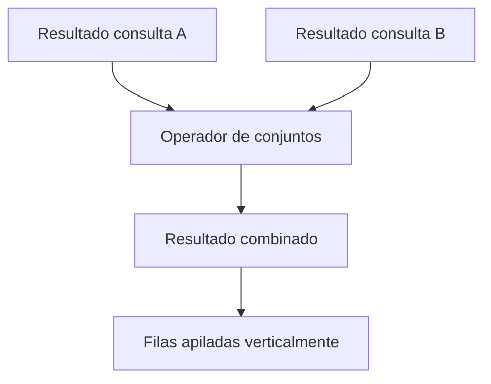
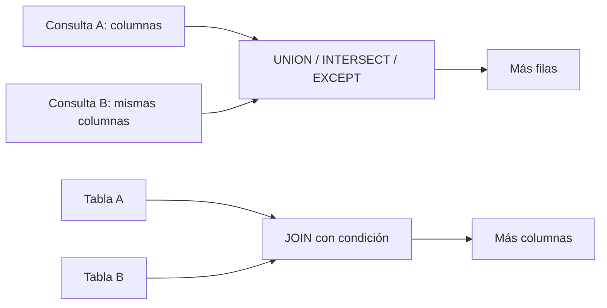
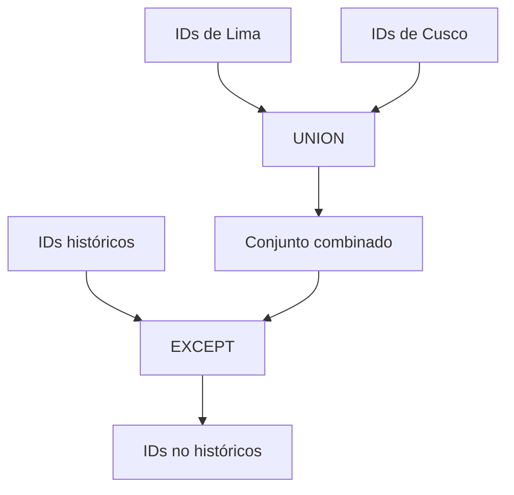
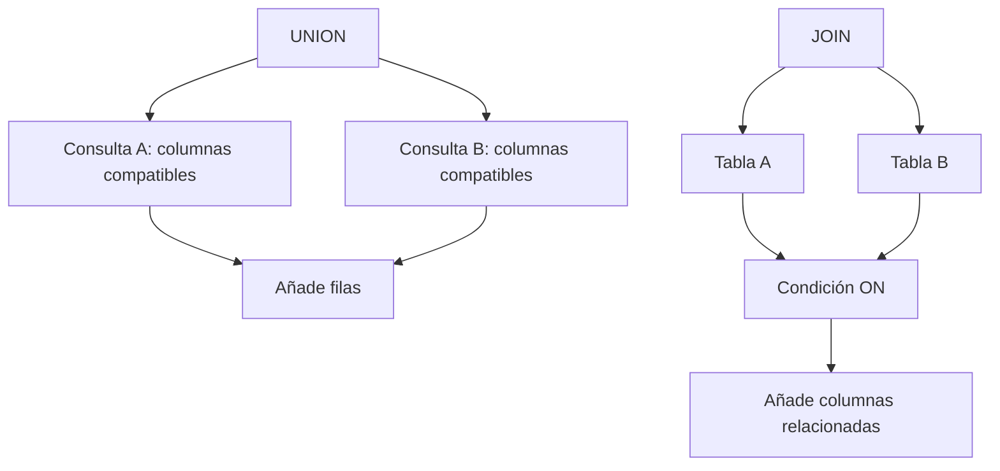
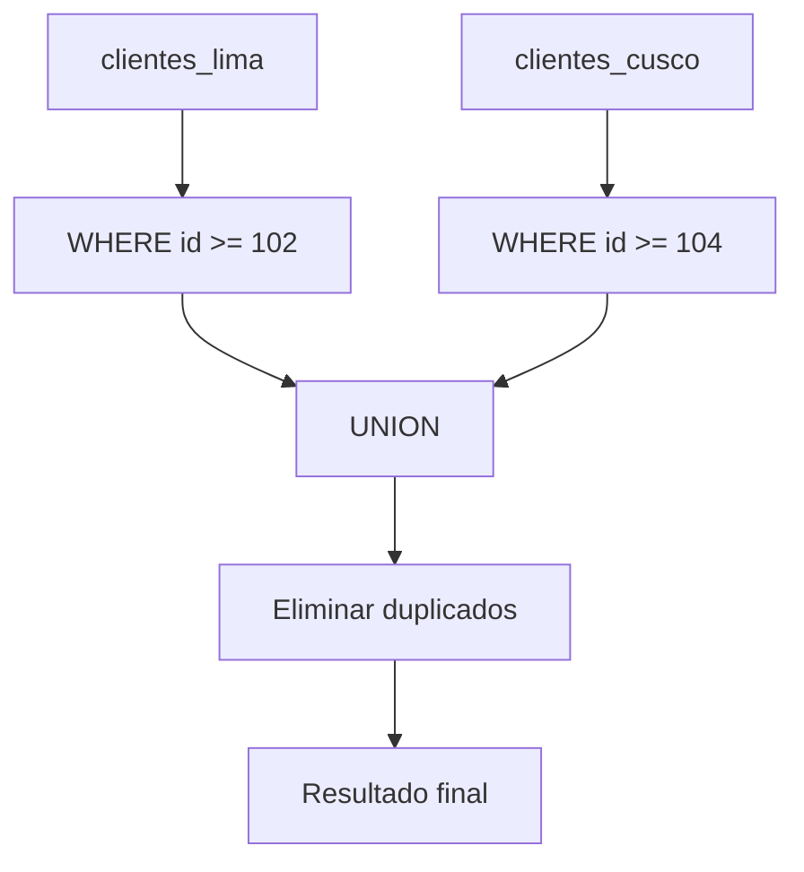
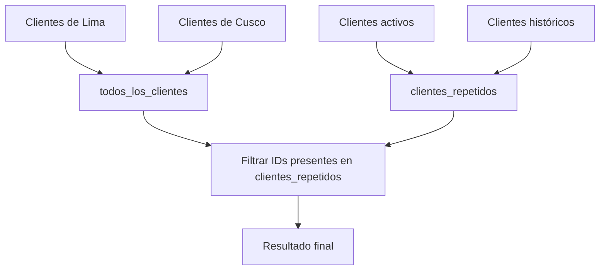

# `UNION`, `INTERSECT` y `EXCEPT` en SQL

`UNION`, `INTERSECT` y `EXCEPT` son operadores de conjuntos. Permiten combinar los resultados de dos o más consultas compatibles.

Estos operadores trabajan de forma **vertical**: agregan filas de una consulta debajo de las filas de otra.

```sql
SELECT columna_a, columna_b
FROM tabla_a

UNION

SELECT columna_a, columna_b
FROM tabla_b;
```

> **Idea central.** Los operadores de conjuntos combinan resultados con la misma estructura; los `JOIN` combinan columnas de tablas relacionadas mediante una condición.

---

## 1. Tablas de ejemplo

Usaremos clientes de dos ciudades, clientes activos e históricos, y tablas de productos.

### `clientes_lima`

```sql
CREATE TABLE clientes_lima (
    id_cliente INT,
    nombre VARCHAR(100),
    correo VARCHAR(150)
);
```

```sql
INSERT INTO clientes_lima (id_cliente, nombre, correo)
VALUES
    (101, 'Ana', 'ana@correo.com'),
    (102, 'Luis', 'luis@correo.com'),
    (103, 'Marta', 'marta@correo.com');
```

| id_cliente | nombre | correo |
| ---: | :--- | :--- |
| 101 | Ana | ana@correo.com |
| 102 | Luis | luis@correo.com |
| 103 | Marta | marta@correo.com |

### `clientes_cusco`

```sql
CREATE TABLE clientes_cusco (
    id_cliente INT,
    nombre VARCHAR(100),
    correo VARCHAR(150)
);
```

```sql
INSERT INTO clientes_cusco (id_cliente, nombre, correo)
VALUES
    (102, 'Luis', 'luis@correo.com'),
    (104, 'Carlos', 'carlos@correo.com'),
    (105, 'Sofía', 'sofia@correo.com');
```

| id_cliente | nombre | correo |
| ---: | :--- | :--- |
| 102 | Luis | luis@correo.com |
| 104 | Carlos | carlos@correo.com |
| 105 | Sofía | sofia@correo.com |

### `clientes_activos`

```sql
CREATE TABLE clientes_activos (
    id_cliente INT,
    nombre VARCHAR(100),
    ciudad VARCHAR(80)
);
```

```sql
INSERT INTO clientes_activos (id_cliente, nombre, ciudad)
VALUES
    (101, 'Ana', 'Lima'),
    (102, 'Luis', 'Cusco'),
    (104, 'Carlos', 'Arequipa');
```

### `clientes_historicos`

```sql
CREATE TABLE clientes_historicos (
    id_cliente INT,
    nombre VARCHAR(100),
    ciudad VARCHAR(80)
);
```

```sql
INSERT INTO clientes_historicos (id_cliente, nombre, ciudad)
VALUES
    (102, 'Luis', 'Cusco'),
    (103, 'Marta', 'Lima'),
    (105, 'Sofía', 'Arequipa');
```

### `productos`

```sql
CREATE TABLE productos (
    id_producto INT,
    nombre VARCHAR(100),
    categoria VARCHAR(50),
    precio DECIMAL(10,2)
);
```

```sql
INSERT INTO productos (id_producto, nombre, categoria, precio)
VALUES
    (1, 'Teclado mecánico', 'periféricos', 149.90),
    (2, 'Mouse inalámbrico', 'periféricos', 79.90),
    (3, 'Monitor 24 pulgadas', 'monitores', 899.00),
    (4, 'Webcam HD', 'cámaras', 219.50);
```

---

## 2. Qué es un operador de conjuntos

Dos consultas pueden combinarse si sus resultados tienen una estructura compatible.

```sql
SELECT id_cliente, nombre
FROM clientes_lima

UNION

SELECT id_cliente, nombre
FROM clientes_cusco;
```

El resultado tiene dos columnas y reúne filas de ambas consultas.

### Flujo vertical



### Operador de conjuntos frente a `JOIN`



> **Qué debes recordar.** Un operador de conjuntos amplía o compara filas; un `JOIN` relaciona columnas de tablas.

---

## 3. `UNION`

`UNION` combina los resultados de dos consultas y elimina filas duplicadas.

```sql
SELECT id_cliente, nombre, correo
FROM clientes_lima

UNION

SELECT id_cliente, nombre, correo
FROM clientes_cusco;
```

### Resultado

| id_cliente | nombre | correo |
| ---: | :--- | :--- |
| 101 | Ana | ana@correo.com |
| 102 | Luis | luis@correo.com |
| 103 | Marta | marta@correo.com |
| 104 | Carlos | carlos@correo.com |
| 105 | Sofía | sofia@correo.com |

Luis aparece una sola vez porque la fila completa es igual en ambas consultas.

## 3.1 Qué significa duplicado

La comparación se realiza sobre todas las columnas seleccionadas.

```sql
SELECT id_cliente, nombre
FROM clientes_lima

UNION

SELECT id_cliente, nombre
FROM clientes_cusco;
```

Si el mismo `id_cliente` tuviera nombres distintos, las filas podrían considerarse diferentes porque la combinación completa de columnas no sería igual.

| id_cliente | nombre | ¿Es la misma fila? |
| ---: | :--- | :---: |
| 102 | Luis | Sí, si todas las columnas coinciden |
| 102 | Luis Alberto | No |

## 3.2 `UNION` con etiquetas

Se pueden añadir valores constantes para identificar el origen.

```sql
SELECT id_cliente, nombre, 'Lima' AS origen
FROM clientes_lima

UNION

SELECT id_cliente, nombre, 'Cusco' AS origen
FROM clientes_cusco;
```

En este caso, Luis aparecería dos veces porque `origen` cambia el contenido de la fila.

| id_cliente | nombre | origen |
| ---: | :--- | :--- |
| 101 | Ana | Lima |
| 102 | Luis | Lima |
| 102 | Luis | Cusco |
| 103 | Marta | Lima |
| 104 | Carlos | Cusco |
| 105 | Sofía | Cusco |

> **Cuidado.** Añadir una columna de origen modifica la lógica de duplicados de `UNION`.

---

## 4. `UNION ALL`

`UNION ALL` combina los resultados y conserva los duplicados.

```sql
SELECT id_cliente, nombre, correo
FROM clientes_lima

UNION ALL

SELECT id_cliente, nombre, correo
FROM clientes_cusco;
```

### Resultado

| id_cliente | nombre | correo |
| ---: | :--- | :--- |
| 101 | Ana | ana@correo.com |
| 102 | Luis | luis@correo.com |
| 103 | Marta | marta@correo.com |
| 102 | Luis | luis@correo.com |
| 104 | Carlos | carlos@correo.com |
| 105 | Sofía | sofia@correo.com |

### `UNION` frente a `UNION ALL`

| Característica | `UNION` | `UNION ALL` |
| :--- | :--- | :--- |
| Combina consultas | Sí | Sí |
| Elimina duplicados | Sí | No |
| Conserva todas las filas | No necesariamente | Sí |
| Trabajo adicional | Puede necesitar deduplicar | Generalmente menor |
| Uso típico | Conjunto único | Historial, eventos o datos ya controlados |

> **Regla práctica.** Usa `UNION ALL` cuando los duplicados sean válidos o cuando sepas que no existen. Usa `UNION` cuando necesites un conjunto sin repeticiones.

---

## 5. Requisitos de compatibilidad

Las consultas combinadas deben ser compatibles.

## 5.1 Mismo número de columnas

```sql
-- Correcto: dos columnas en ambos SELECT
SELECT id_cliente, nombre
FROM clientes_lima
UNION
SELECT id_cliente, nombre
FROM clientes_cusco;
```

```sql
-- Incorrecto: tres columnas contra dos
SELECT id_cliente, nombre, correo
FROM clientes_lima
UNION
SELECT id_cliente, nombre
FROM clientes_cusco;
```

## 5.2 Tipos compatibles

Las columnas en la misma posición deben tener tipos compatibles.

```sql
SELECT id_cliente, nombre
FROM clientes_lima

UNION

SELECT id_cliente, nombre
FROM clientes_cusco;
```

| Posición | Primera consulta | Segunda consulta |
| ---: | :--- | :--- |
| 1 | `INT` | `INT` |
| 2 | `VARCHAR` | `VARCHAR` |

## 5.3 Los nombres provienen de la primera consulta

```sql
SELECT id_cliente AS codigo, nombre AS cliente
FROM clientes_lima

UNION

SELECT id_cliente AS id, nombre AS nombre_completo
FROM clientes_cusco;
```

Los nombres finales serán `codigo` y `cliente`, porque los alias de la primera consulta definen las columnas de salida.

## 5.4 Orden de columnas

El motor empareja las columnas por posición, no por nombre.

```sql
SELECT id_cliente, nombre
FROM clientes_lima

UNION

SELECT nombre, id_cliente
FROM clientes_cusco;
```

Esta consulta puede producir conversiones incorrectas o un error porque las posiciones no representan el mismo tipo de dato.

> **Recomendación.** Escribe las columnas explícitamente y mantenlas en el mismo orden semántico.

---

## 6. `INTERSECT`

`INTERSECT` devuelve únicamente las filas que aparecen en ambas consultas.

```sql
SELECT id_cliente, nombre, ciudad
FROM clientes_activos

INTERSECT

SELECT id_cliente, nombre, ciudad
FROM clientes_historicos;
```

### Resultado

| id_cliente | nombre | ciudad |
| ---: | :--- | :--- |
| 102 | Luis | Cusco |

Luis aparece en las dos tablas con exactamente los mismos valores.

### Diagrama de conjuntos


## 6.1 `INTERSECT` compara la fila completa

```sql
SELECT id_cliente, nombre
FROM clientes_activos

INTERSECT

SELECT id_cliente, nombre
FROM clientes_historicos;
```

La fila debe coincidir en `id_cliente` y `nombre`.

Si se desea comparar únicamente identificadores, se selecciona solo ese identificador:

```sql
SELECT id_cliente
FROM clientes_activos

INTERSECT

SELECT id_cliente
FROM clientes_historicos;
```

### Resultado

| id_cliente |
| ---: |
| 102 |

> **Idea práctica.** Las columnas seleccionadas determinan qué significa “estar en ambos conjuntos”.

---

## 7. `EXCEPT`

`EXCEPT` devuelve las filas de la primera consulta que no aparecen en la segunda.

```sql
SELECT id_cliente, nombre, ciudad
FROM clientes_activos

EXCEPT

SELECT id_cliente, nombre, ciudad
FROM clientes_historicos;
```

### Resultado

| id_cliente | nombre | ciudad |
| ---: | :--- | :--- |
| 101 | Ana | Lima |
| 104 | Carlos | Arequipa |

Luis se elimina porque también aparece en `clientes_historicos`.

### Diagrama


> **Importante.** El orden importa: `A EXCEPT B` no produce necesariamente lo mismo que `B EXCEPT A`.

## 7.1 Intercambiar el orden

```sql
SELECT id_cliente, nombre, ciudad
FROM clientes_historicos

EXCEPT

SELECT id_cliente, nombre, ciudad
FROM clientes_activos;
```

### Resultado

| id_cliente | nombre | ciudad |
| ---: | :--- | :--- |
| 103 | Marta | Lima |
| 105 | Sofía | Arequipa |

| Expresión | Significado |
| :--- | :--- |
| `A EXCEPT B` | Filas de A que no están en B |
| `B EXCEPT A` | Filas de B que no están en A |

---

## 8. Duplicados en operadores de conjuntos

`UNION`, `INTERSECT` y `EXCEPT` normalmente eliminan duplicados. Sus variantes `ALL` conservan repeticiones cuando el motor las soporta.

| Operador | Elimina duplicados | Variante `ALL` |
| :--- | :---: | :--- |
| `UNION` | Sí | `UNION ALL` |
| `INTERSECT` | Sí | `INTERSECT ALL` en algunos motores |
| `EXCEPT` | Sí | `EXCEPT ALL` en algunos motores |

### Conteo conceptual

Si una fila aparece:

- 3 veces en A.
- 2 veces en B.

Entonces, según la semántica de conjuntos multiconjunto:

| Operador | Veces que podría aparecer |
| :--- | ---: |
| `INTERSECT ALL` | 2 |
| `EXCEPT ALL` de A respecto a B | 1 |
| `UNION ALL` | 5 |

> **Compatibilidad.** `INTERSECT ALL` y `EXCEPT ALL` no están disponibles de la misma forma en todos los motores. Comprueba la documentación del SGBD.

---

## 9. `ORDER BY` con operadores de conjuntos

El `ORDER BY` normalmente se coloca al final de toda la combinación.

```sql
SELECT id_cliente, nombre
FROM clientes_lima

UNION

SELECT id_cliente, nombre
FROM clientes_cusco

ORDER BY nombre ASC;
```

### Resultado ordenado

| id_cliente | nombre |
| ---: | :--- |
| 101 | Ana |
| 104 | Carlos |
| 102 | Luis |
| 103 | Marta |
| 105 | Sofía |

### Ordenar por posición

Algunos motores permiten:

```sql
ORDER BY 2 ASC;
```

Esto ordena por la segunda columna, `nombre`, pero puede ser menos claro si cambia la consulta.

### `LIMIT`

```sql
(
    SELECT id_cliente, nombre
    FROM clientes_lima
    ORDER BY nombre
    LIMIT 2
)
UNION ALL
(
    SELECT id_cliente, nombre
    FROM clientes_cusco
    ORDER BY nombre
    LIMIT 2
);
```

Los paréntesis pueden ser necesarios para aplicar `ORDER BY` y `LIMIT` a cada consulta individual. La sintaxis exacta depende del motor.

---

## 10. Precedencia y paréntesis

Cuando se combinan varios operadores, utiliza paréntesis para dejar claro el orden.

```sql
(
    SELECT id_cliente FROM clientes_lima
    UNION
    SELECT id_cliente FROM clientes_cusco
)
EXCEPT
SELECT id_cliente FROM clientes_historicos;
```

### Lectura por etapas



> **Regla práctica.** Si una expresión combina más de un operador de conjunto, usa paréntesis aunque el motor conozca la precedencia.

---

## 11. Operadores de conjuntos frente a `JOIN`

Esta es una diferencia fundamental.

## 11.1 Operadores de conjuntos: combinar filas

```sql
SELECT id_cliente, nombre
FROM clientes_lima

UNION

SELECT id_cliente, nombre
FROM clientes_cusco;
```

Resultado conceptual:

| id_cliente | nombre |
| ---: | :--- |
| 101 | Ana |
| 102 | Luis |
| 103 | Marta |
| 104 | Carlos |
| 105 | Sofía |

La segunda consulta se apila debajo de la primera.

## 11.2 `JOIN`: combinar columnas

Supón una tabla central de clientes:

```sql
CREATE TABLE clientes (
    id_cliente INT PRIMARY KEY,
    nombre VARCHAR(100),
    ciudad VARCHAR(80)
);
```

```sql
SELECT
    c.nombre,
    p.id_pedido,
    p.total
FROM clientes AS c
JOIN pedidos AS p
    ON p.id_cliente = c.id_cliente;
```

Resultado conceptual:

| nombre | id_pedido | total |
| :--- | ---: | ---: |
| Ana | 1001 | 149.90 |
| Ana | 1003 | 899.00 |
| Luis | 1002 | 79.90 |

El `JOIN` coloca columnas de `clientes` y `pedidos` en la misma fila relacionada.

### Comparación visual



---

## 12. `UNION` frente a `JOIN`

| Pregunta | `UNION` | `JOIN` |
| :--- | :--- | :--- |
| ¿Qué combina? | Filas de consultas compatibles | Columnas de tablas relacionadas |
| Dirección conceptual | Vertical | Horizontal |
| ¿Necesita una condición `ON`? | No | Normalmente sí |
| ¿Necesita el mismo número de columnas? | Sí | No |
| ¿Qué relación exige? | Estructura compatible | Claves o condición de relación |
| ¿Puede eliminar duplicados? | `UNION` sí | No automáticamente |
| Uso típico | Unificar fuentes similares | Enriquecer datos con información relacionada |

### Ejemplo para elegir

| Necesidad | Operador adecuado |
| :--- | :--- |
| Unir clientes de Lima y Cusco en una lista | `UNION` |
| Mostrar clientes junto con sus pedidos | `JOIN` |
| Encontrar clientes presentes en dos listas | `INTERSECT` |
| Encontrar clientes activos que no están en históricos | `EXCEPT` |
| Añadir el nombre del cliente a cada pedido | `JOIN` |
| Concatenar ventas de dos períodos con la misma estructura | `UNION ALL` |

### Comparación visual de resultados

| Operación | Entrada principal | Resultado | Dirección | ¿Elimina duplicados? |
| :--- | :--- | :--- | :---: | :---: |
| `UNION` | Dos listas compatibles | Todos los elementos únicos | Vertical | Sí |
| `UNION ALL` | Dos listas compatibles | Todos los elementos, incluidos repetidos | Vertical | No |
| `INTERSECT` | Dos listas compatibles | Elementos presentes en ambas | Vertical | Sí |
| `EXCEPT` | Dos listas compatibles | Elementos de la primera que faltan en la segunda | Vertical | Sí |
| `INNER JOIN` | Dos tablas relacionadas | Filas con coincidencia y columnas combinadas | Horizontal | No automáticamente |
| `LEFT JOIN` | Tabla izquierda y tabla relacionada | Todas las filas izquierdas, coincidan o no | Horizontal | No automáticamente |

---

## 13. Simular operadores de conjuntos con `JOIN`

En motores que no soportan `INTERSECT` o `EXCEPT`, se pueden utilizar joins o subconsultas.

## 13.1 Simular `INTERSECT` con `INNER JOIN`

```sql
SELECT DISTINCT
    a.id_cliente,
    a.nombre,
    a.ciudad
FROM clientes_activos AS a
INNER JOIN clientes_historicos AS h
    ON h.id_cliente = a.id_cliente
   AND h.nombre = a.nombre
   AND h.ciudad = a.ciudad;
```

El `INNER JOIN` conserva coincidencias entre ambas tablas.

### Ejecución paso a paso de `INTERSECT` con `INNER JOIN`

Para visualizar la diferencia, supongamos que el conjunto histórico tiene dos registros para Luis:

| Tabla | id_cliente | nombre | ciudad |
| :--- | ---: | :--- | :--- |
| `clientes_activos` | 101 | Ana | Lima |
| `clientes_activos` | 102 | Luis | Cusco |
| `clientes_historicos` | 102 | Luis | Cusco |
| `clientes_historicos` | 102 | Luis | Cusco |

El `INNER JOIN` compara cada fila de la izquierda con las coincidencias de la derecha:

| Fila activa | Coincidencias históricas encontradas | Filas generadas por el `JOIN` |
| :--- | ---: | ---: |
| Ana (101) | 0 | 0 |
| Luis (102) | 2 | 2 |

### Resultado de cada técnica

| Técnica | Resultado de ejecución |
| :--- | :--- |
| `INTERSECT` | Luis (102), una sola vez |
| `INNER JOIN` sin `DISTINCT` | Luis (102), dos veces |
| `INNER JOIN` con `DISTINCT` | Luis (102), una sola vez |
| `EXISTS` | Luis (102), una sola vez |

La tabla muestra por qué un `JOIN` puede multiplicar filas cuando existen varias coincidencias, mientras que `INTERSECT` y `EXISTS` expresan una comprobación de existencia.

### Con `EXISTS`

```sql
SELECT a.id_cliente, a.nombre, a.ciudad
FROM clientes_activos AS a
WHERE EXISTS (
    SELECT 1
    FROM clientes_historicos AS h
    WHERE h.id_cliente = a.id_cliente
      AND h.nombre = a.nombre
      AND h.ciudad = a.ciudad
);
```

## 13.2 Simular `EXCEPT` con `LEFT JOIN`

```sql
SELECT
    a.id_cliente,
    a.nombre,
    a.ciudad
FROM clientes_activos AS a
LEFT JOIN clientes_historicos AS h
    ON h.id_cliente = a.id_cliente
   AND h.nombre = a.nombre
   AND h.ciudad = a.ciudad
WHERE h.id_cliente IS NULL;
```

### Con `NOT EXISTS`

```sql
SELECT a.id_cliente, a.nombre, a.ciudad
FROM clientes_activos AS a
WHERE NOT EXISTS (
    SELECT 1
    FROM clientes_historicos AS h
    WHERE h.id_cliente = a.id_cliente
      AND h.nombre = a.nombre
      AND h.ciudad = a.ciudad
);
```

### Comparación

| Operador | Alternativa frecuente |
| :--- | :--- |
| `INTERSECT` | `INNER JOIN` o `EXISTS` |
| `EXCEPT` | `LEFT JOIN ... IS NULL` o `NOT EXISTS` |
| `UNION` | `UNION ALL` seguido de `DISTINCT` |

### Qué cambia en cada alternativa

| Necesidad | Operador de conjunto | Alternativa con consulta relacionada | Diferencia importante |
| :--- | :--- | :--- | :--- |
| Conservar coincidencias | `INTERSECT` | `INNER JOIN` o `EXISTS` | El `JOIN` puede repetir filas |
| Obtener ausencias | `EXCEPT` | `LEFT JOIN ... IS NULL` o `NOT EXISTS` | El `LEFT JOIN` puede mostrar columnas auxiliares |
| Unir listas | `UNION` | `UNION ALL` + `DISTINCT` | La deduplicación se hace en un paso separado |
| Comparar solo una clave | Seleccionar solo la clave | Condicionar el `JOIN` por la clave | Las columnas seleccionadas determinan la comparación |

> **Cuidado con los duplicados.** Un `JOIN` puede repetir filas si existen varias coincidencias; `INTERSECT` normalmente devuelve una fila única por combinación.

---

## 14. Diferencia con `INNER JOIN`

Un `INNER JOIN` no equivale siempre a `INTERSECT`.

### `INTERSECT`

Compara filas y devuelve una vez las coincidencias:

```sql
SELECT id_cliente
FROM clientes_activos
INTERSECT
SELECT id_cliente
FROM clientes_historicos;
```

### `INNER JOIN`

Puede repetir una fila si hay múltiples coincidencias:

```sql
SELECT a.id_cliente
FROM clientes_activos AS a
JOIN clientes_historicos AS h
    ON h.id_cliente = a.id_cliente;
```

| Situación | `INTERSECT` | `INNER JOIN` |
| :--- | :--- | :--- |
| Una coincidencia | Una fila | Una fila |
| Varias coincidencias | Normalmente una fila distinta | Varias filas posibles |
| Columnas del resultado | Las definidas por la consulta | Puede incluir columnas de ambas tablas |
| Eliminación de duplicados | Propia del operador | Requiere `DISTINCT` si se necesita |

### Ejemplo de resultados

| Datos de entrada | `INTERSECT` | `INNER JOIN` sin `DISTINCT` |
| :--- | :--- | :--- |
| A tiene `101, 102` y B tiene `102, 102` | `102` una vez | `102` puede aparecer dos veces |
| A tiene `101` y B no tiene coincidencias | Ninguna fila | Ninguna fila |
| A tiene columnas `id, nombre` y B también | Devuelve las columnas seleccionadas | Puede devolver columnas de A y B |

### Ejecución fila por fila

Supongamos estas filas de entrada:

| Conjunto A: activos | Conjunto B: históricos |
| :--- | :--- |
| 101 - Ana | 102 - Luis |
| 102 - Luis | 102 - Luis |
|  | 104 - Carlos |

La comparación produce:

| Fila de A | ¿Existe en B? | Resultado de `INTERSECT` | Resultado del `INNER JOIN` |
| :--- | :---: | :---: | :---: |
| 101 - Ana | No | Se descarta | Se descarta |
| 102 - Luis | Sí | Se conserva una vez | Se conserva una vez por coincidencia |

Si B tuviera dos filas para Luis, el `INTERSECT` seguiría mostrando una fila, pero el `INNER JOIN` produciría dos filas, salvo que se agregue `DISTINCT`.

> **Conclusión.** Si solo quieres saber qué elementos aparecen en ambos conjuntos, `INTERSECT` o `EXISTS` expresan mejor la intención. Si necesitas columnas de ambas tablas, utiliza `JOIN`.

---

## 15. Diferencia con `LEFT JOIN`

`EXCEPT` puede expresar una diferencia de conjuntos; `LEFT JOIN` permite obtener además información de la tabla izquierda y detectar ausencia de coincidencia.

### `EXCEPT`

```sql
SELECT id_cliente
FROM clientes_activos
EXCEPT
SELECT id_cliente
FROM clientes_historicos;
```

### `LEFT JOIN`

```sql
SELECT
    a.id_cliente,
    a.nombre,
    h.id_cliente AS id_historico
FROM clientes_activos AS a
LEFT JOIN clientes_historicos AS h
    ON h.id_cliente = a.id_cliente;
```

El `LEFT JOIN` puede mostrar tanto las coincidencias como las ausencias; `EXCEPT` devuelve directamente la diferencia.

### Ejecución paso a paso de `EXCEPT` con `LEFT JOIN`

Con estos datos:

| `clientes_activos` | `clientes_historicos` |
| :--- | :--- |
| 101 - Ana | 102 - Luis |
| 102 - Luis | 103 - Marta |
| 104 - Carlos |  |

El `LEFT JOIN` conserva primero todas las filas activas:

| id_cliente activo | nombre activo | id_cliente histórico | Coincidencia |
| ---: | :--- | ---: | :---: |
| 101 | Ana | `NULL` | No |
| 102 | Luis | 102 | Sí |
| 104 | Carlos | `NULL` | No |

Después se aplica el filtro:

```sql
WHERE h.id_cliente IS NULL
```

| Fila después del `LEFT JOIN` | ¿Pasa `h.id_cliente IS NULL`? | Resultado final |
| :--- | :---: | :--- |
| Ana (101), histórico `NULL` | Sí | Se conserva |
| Luis (102), histórico 102 | No | Se elimina |
| Carlos (104), histórico `NULL` | Sí | Se conserva |

Por eso el resultado equivale a `EXCEPT`: Ana (101) y Carlos (104).

### Ejemplo de resultados

| Cliente activo | ¿Está en históricos? | `EXCEPT` | `LEFT JOIN` sin filtro |
| :--- | :---: | :---: | :--- |
| Ana (101) | No | Devuelve 101 | Ana, `NULL` |
| Luis (102) | Sí | No devuelve 102 | Luis, 102 |
| Carlos (104) | No | Devuelve 104 | Carlos, `NULL` |

Para que el `LEFT JOIN` produzca el mismo conjunto que `EXCEPT`, se añade:

```sql
WHERE h.id_cliente IS NULL
```

| Técnica | Muestra coincidencias | Muestra ausencias | Puede traer columnas de ambas tablas |
| :--- | :---: | :---: | :---: |
| `EXCEPT` | No | Sí | No, salvo las columnas de la primera consulta |
| `LEFT JOIN` sin filtro | Sí | Sí | Sí |
| `LEFT JOIN ... IS NULL` | No | Sí | Sí, aunque las columnas derechas serán `NULL` |

### Comparación de ejecución completa

| Etapa | `EXCEPT` | `LEFT JOIN` sin filtro | `LEFT JOIN ... IS NULL` |
| :--- | :--- | :--- | :--- |
| 1. Comparar activos con históricos | Busca filas ausentes | Relaciona coincidencias | Relaciona coincidencias |
| 2. Filas intermedias | Solo prepara la diferencia | Conserva coincidencias y ausencias | Conserva coincidencias y ausencias |
| 3. Filtro final | Implícito en el operador | No hay filtro de ausencia | `h.id_cliente IS NULL` |
| 4. Resultado | Solo Ana y Carlos | Ana, Luis y Carlos | Solo Ana y Carlos |
| 5. Columnas disponibles | Columnas seleccionadas de activos | Columnas de ambas tablas | Columnas de activos y posibles columnas históricas nulas |

---

## 16. `NULL` en operadores de conjuntos

Los valores `NULL` requieren atención.

En una comparación de filas, dos valores `NULL` pueden tratarse como equivalentes según la semántica del operador y del motor, pero no debes asumir que todas las comparaciones con `=` se comportan igual.

```sql
SELECT correo
FROM clientes_lima

INTERSECT

SELECT correo
FROM clientes_cusco;
```

Si ambas consultas tienen un correo `NULL`, revisa la documentación del motor para confirmar el comportamiento exacto.

### Alternativa explícita con joins

Cuando se simula un operador con `JOIN`, la condición `a.columna = b.columna` no coincide con `NULL = NULL` porque esa expresión no es verdadera.

Para tratar `NULL` como igual, algunos motores ofrecen comparación segura, o se puede escribir una condición explícita:

```sql
ON (
    a.correo = h.correo
    OR (a.correo IS NULL AND h.correo IS NULL)
)
```

> **Recomendación.** Prueba los casos con `NULL` en el motor concreto antes de convertir un operador de conjuntos a un `JOIN`.

---

## 17. Combinar operadores con filtros

Cada consulta puede tener su propio `WHERE`.

```sql
SELECT id_cliente, nombre
FROM clientes_lima
WHERE id_cliente >= 102

UNION

SELECT id_cliente, nombre
FROM clientes_cusco
WHERE id_cliente >= 104;
```

### Lectura por etapas



El filtro de cada rama se aplica antes de la combinación.

---

## 18. Agregaciones después de combinar

Se puede envolver el operador de conjuntos en una subconsulta y luego agrupar.

```sql
SELECT
    ciudad,
    COUNT(*) AS cantidad_clientes
FROM (
    SELECT id_cliente, nombre, 'Lima' AS ciudad
    FROM clientes_lima

    UNION ALL

    SELECT id_cliente, nombre, 'Cusco' AS ciudad
    FROM clientes_cusco
) AS todos
GROUP BY ciudad;
```

### Resultado

| ciudad | cantidad_clientes |
| :--- | ---: |
| Cusco | 3 |
| Lima | 3 |

Como se utilizó `UNION ALL`, Luis se cuenta en cada origen. Si se quisiera contar clientes únicos, habría que definir cómo se determina una única ciudad o deduplicar por identificador.

---

## 19. CTE con operadores de conjuntos

Las CTE ayudan a nombrar cada etapa.

```sql
WITH todos_los_clientes AS (
    SELECT id_cliente, nombre
    FROM clientes_lima

    UNION

    SELECT id_cliente, nombre
    FROM clientes_cusco
), clientes_repetidos AS (
    SELECT id_cliente, nombre
    FROM clientes_activos

    INTERSECT

    SELECT id_cliente, nombre
    FROM clientes_historicos
)
SELECT *
FROM todos_los_clientes
WHERE id_cliente IN (
    SELECT id_cliente
    FROM clientes_repetidos
);
```

### Flujo



---

## 20. Rendimiento y buenas prácticas

| Recomendación | Motivo |
| :--- | :--- |
| Usar `UNION ALL` cuando no se necesite deduplicar | Evita trabajo adicional |
| Seleccionar solo columnas necesarias | Reduce comparación y transferencia |
| Mantener tipos compatibles | Evita conversiones implícitas |
| Filtrar cada rama antes de combinar | Reduce filas intermedias |
| Indexar columnas usadas en alternativas con `JOIN` | Puede acelerar coincidencias |
| Revisar duplicados conscientemente | Cambian el resultado de `UNION` y joins |
| Usar `EXPLAIN` | Permite comprobar el plan de ejecución |
| Usar paréntesis en expresiones complejas | Evita ambigüedad de precedencia |
| No usar `JOIN` solo porque combina tablas | Elegir la operación que representa la pregunta |

### Comparar planes

```sql
EXPLAIN
SELECT id_cliente
FROM clientes_activos
INTERSECT
SELECT id_cliente
FROM clientes_historicos;
```

Y comparar con:

```sql
EXPLAIN
SELECT DISTINCT a.id_cliente
FROM clientes_activos AS a
JOIN clientes_historicos AS h
    ON h.id_cliente = a.id_cliente;
```

El rendimiento depende del motor, estadísticas, índices y cantidad de duplicados.

---

## 21. Errores comunes

| Error | Qué ocurre | Cómo evitarlo |
| :--- | :--- | :--- |
| Seleccionar distinto número de columnas | El operador no puede combinar los resultados | Igualar la cantidad de columnas |
| Mezclar tipos incompatibles | Puede producir error o conversiones inesperadas | Usar `CAST` cuando sea necesario |
| Confundir posición con nombre | Las columnas se emparejan por posición | Mantener el mismo orden |
| Creer que `UNION` conserva duplicados | Los duplicados se eliminan | Usar `UNION ALL` |
| Poner `ORDER BY` en una rama sin paréntesis | Puede ordenar toda la combinación o fallar | Colocar `ORDER BY` al final o usar paréntesis |
| Suponer que `INTERSECT` compara solo una clave | Compara todas las columnas seleccionadas | Seleccionar únicamente la clave si eso se necesita |
| Invertir `EXCEPT` | La diferencia cambia completamente | Revisar cuál es el conjunto izquierdo |
| Reemplazar `INTERSECT` con `JOIN` sin `DISTINCT` | Puede producir duplicados | Controlar cardinalidad o usar `EXISTS` |
| Usar `JOIN` para concatenar tablas iguales | La consulta puede multiplicar columnas y filas | Usar `UNION ALL` |
| Ignorar `NULL` | Una simulación con join puede cambiar resultados | Tratar explícitamente los nulos |
| Confundir `UNION` con `JOIN` | Se elige la operación equivocada | Preguntar si se necesitan más filas o más columnas |
| No revisar compatibilidad del motor | `INTERSECT ALL` o `EXCEPT` pueden no existir | Consultar la documentación del SGBD |

### Ejemplo de elección incorrecta

```sql
-- Incorrecto si se desea apilar dos listados equivalentes
SELECT *
FROM clientes_lima AS l
JOIN clientes_cusco AS c
    ON l.id_cliente = c.id_cliente;
```

```sql
-- Correcto para concatenar los dos listados
SELECT id_cliente, nombre, correo
FROM clientes_lima
UNION ALL
SELECT id_cliente, nombre, correo
FROM clientes_cusco;
```

---

## 22. Práctica guiada

## Pregunta 1: unir listas

Combina los clientes de Lima y Cusco sin duplicados.

<details>
<summary>Ver respuesta</summary>

```sql
SELECT id_cliente, nombre, correo
FROM clientes_lima
UNION
SELECT id_cliente, nombre, correo
FROM clientes_cusco;
```

</details>

## Pregunta 2: conservar duplicados

Combina las listas conservando las repeticiones.

<details>
<summary>Ver respuesta</summary>

```sql
SELECT id_cliente, nombre, correo
FROM clientes_lima
UNION ALL
SELECT id_cliente, nombre, correo
FROM clientes_cusco;
```

</details>

## Pregunta 3: encontrar coincidencias

Obtén los clientes que aparecen como activos e históricos.

<details>
<summary>Ver respuesta</summary>

```sql
SELECT id_cliente, nombre, ciudad
FROM clientes_activos
INTERSECT
SELECT id_cliente, nombre, ciudad
FROM clientes_historicos;
```

</details>

## Pregunta 4: encontrar diferencias

Obtén los clientes activos que no aparecen en históricos.

<details>
<summary>Ver respuesta</summary>

```sql
SELECT id_cliente, nombre, ciudad
FROM clientes_activos
EXCEPT
SELECT id_cliente, nombre, ciudad
FROM clientes_historicos;
```

</details>

## Pregunta 5: elegir entre `UNION` y `JOIN`

Muestra el nombre de cada cliente junto con sus pedidos.

<details>
<summary>Ver respuesta</summary>

```sql
SELECT
    c.nombre,
    p.id_pedido,
    p.total
FROM clientes AS c
JOIN pedidos AS p
    ON p.id_cliente = c.id_cliente;
```

Aquí se utiliza `JOIN` porque se necesitan columnas relacionadas de ambas tablas, no dos listas que deban apilarse.

</details>

---

## 23. Mini desafío final

Usa las tablas de ejemplo para resolver:

1. Crear un único listado de clientes de Lima y Cusco sin duplicados.
2. Crear un historial que conserve todas las apariciones, incluso repetidas.
3. Encontrar los clientes que están en activos e históricos.
4. Encontrar los clientes activos que no están en históricos.
5. Obtener los clientes históricos que no están en activos.
6. Explicar por qué `UNION` no reemplaza a un `JOIN`.
7. Simular `INTERSECT` usando `EXISTS`.
8. Simular `EXCEPT` usando `NOT EXISTS`.
9. Añadir una columna de origen y observar cómo cambia la deduplicación.

### Una solución posible

```sql
-- 1. Lista única
SELECT id_cliente, nombre, correo
FROM clientes_lima
UNION
SELECT id_cliente, nombre, correo
FROM clientes_cusco;

-- 2. Historial completo
SELECT id_cliente, nombre, correo, 'Lima' AS origen
FROM clientes_lima
UNION ALL
SELECT id_cliente, nombre, correo, 'Cusco' AS origen
FROM clientes_cusco;

-- 3. Coincidencias
SELECT id_cliente
FROM clientes_activos
INTERSECT
SELECT id_cliente
FROM clientes_historicos;

-- 4. Activos que no están en históricos
SELECT id_cliente
FROM clientes_activos
EXCEPT
SELECT id_cliente
FROM clientes_historicos;

-- 5. Históricos que no están en activos
SELECT id_cliente
FROM clientes_historicos
EXCEPT
SELECT id_cliente
FROM clientes_activos;

-- 6. Simular INTERSECT con EXISTS
SELECT a.id_cliente
FROM clientes_activos AS a
WHERE EXISTS (
    SELECT 1
    FROM clientes_historicos AS h
    WHERE h.id_cliente = a.id_cliente
);

-- 7. Simular EXCEPT con NOT EXISTS
SELECT a.id_cliente
FROM clientes_activos AS a
WHERE NOT EXISTS (
    SELECT 1
    FROM clientes_historicos AS h
    WHERE h.id_cliente = a.id_cliente
);
```

### Tabla de decisión

| Necesidad | Técnica recomendada |
| :--- | :--- |
| Apilar resultados compatibles | `UNION ALL` |
| Apilar y eliminar duplicados | `UNION` |
| Obtener coincidencias entre conjuntos | `INTERSECT` o `EXISTS` |
| Obtener filas del primer conjunto que faltan en el segundo | `EXCEPT` o `NOT EXISTS` |
| Combinar columnas relacionadas | `JOIN` |
| Mantener todas las filas de la izquierda | `LEFT JOIN` |
| Detectar coincidencias con múltiples resultados | `EXISTS` |
| Deduplicar un `JOIN` | `DISTINCT`, si representa la lógica correcta |

---

## 24. Resumen final

- `UNION` combina consultas compatibles y elimina duplicados.
- `UNION ALL` combina consultas y conserva duplicados.
- `INTERSECT` devuelve filas presentes en ambos resultados.
- `EXCEPT` devuelve filas de la primera consulta que no aparecen en la segunda.
- Los operadores comparan las columnas seleccionadas completas.
- Las consultas deben tener el mismo número de columnas.
- Las columnas correspondientes deben tener tipos compatibles.
- El orden de columnas es importante.
- Los nombres finales normalmente provienen de la primera consulta.
- `ORDER BY` suele colocarse al final de la combinación.
- Los paréntesis ayudan cuando se combinan varios operadores.
- `UNION` agrega filas; `JOIN` agrega columnas relacionadas.
- `INTERSECT` puede relacionarse con `INNER JOIN` o `EXISTS`.
- `EXCEPT` puede relacionarse con `LEFT JOIN ... IS NULL` o `NOT EXISTS`.
- Un `JOIN` puede generar duplicados por cardinalidad; los operadores de conjuntos suelen deduplicar.
- `UNION ALL` suele ser más eficiente cuando no se necesita eliminar duplicados.
- La compatibilidad de `INTERSECT ALL` y `EXCEPT ALL` depende del motor.

> **Qué debes recordar.** Si tienes dos resultados con estructura semejante y quieres apilarlos o compararlos, piensa en operadores de conjuntos. Si necesitas traer columnas relacionadas desde otra tabla, piensa en `JOIN`.

---

## Relacionado con otros temas

- [JOIN](joins.md): combina columnas de tablas relacionadas.
- [Subconsultas](subqueries.md): permite simular `INTERSECT` y `EXCEPT` con `EXISTS`.
- [CTE y `WITH`](cte-with.md): organiza combinaciones de conjuntos por etapas.
- [Agregaciones y `GROUP BY`](agregaciones-group-by.md): resume resultados después de una combinación.
- [HAVING](having.md): filtra grupos agrupados.
- [Window Functions](window-functions.md): calcula información relacionada sin reducir filas.
- [WHERE y operadores](../02-consultas-basicas/where-operadores.md): filtra cada rama antes de combinarla.
- [`SELECT` y `FROM`](../02-consultas-basicas/select-from.md): estructura de las consultas que forman cada conjunto.
