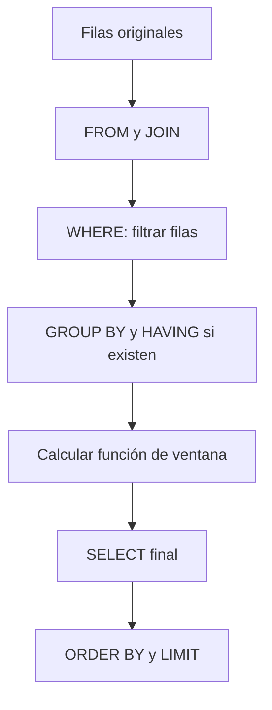
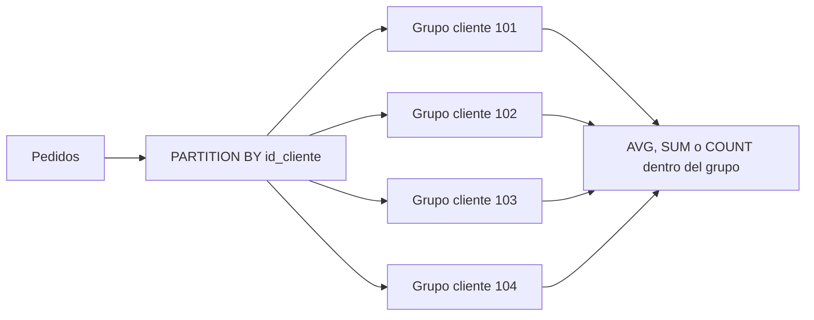
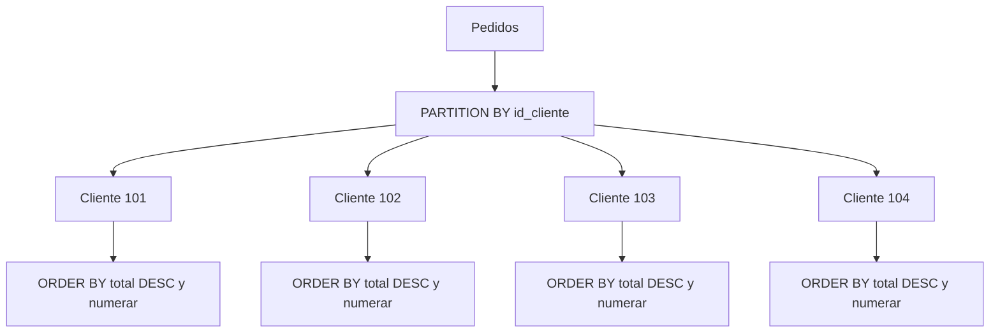
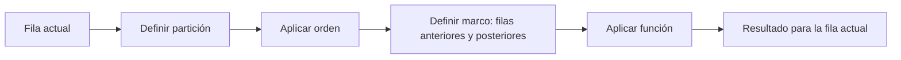
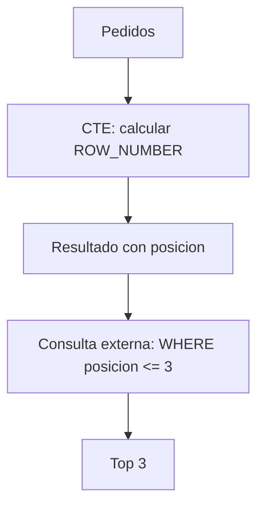

# Funciones de ventana (`Window Functions`)

Las funciones de ventana calculan valores sobre un conjunto de filas relacionadas con la fila actual, pero sin eliminar el detalle original.

A diferencia de `GROUP BY`, una función de ventana agrega información sin convertir varias filas en una sola.

```sql
FUNCION(...) OVER (
    PARTITION BY columna
    ORDER BY columna
)
```

> **Idea central.** `GROUP BY` reduce las filas; una función de ventana conserva cada fila y añade un cálculo relacionado con su grupo o posición.

---

## 1. Tablas de ejemplo

Usaremos las tablas `clientes` y `pedidos`.

### `clientes`

```sql
CREATE TABLE clientes (
    id_cliente INT PRIMARY KEY,
    nombre VARCHAR(100) NOT NULL,
    ciudad VARCHAR(80)
);
```

```sql
INSERT INTO clientes (id_cliente, nombre, ciudad)
VALUES
    (101, 'Ana', 'Lima'),
    (102, 'Luis', 'Cusco'),
    (103, 'Marta', 'Lima'),
    (104, 'Carlos', 'Arequipa');
```

| id_cliente | nombre | ciudad |
| ---: | :--- | :--- |
| 101 | Ana | Lima |
| 102 | Luis | Cusco |
| 103 | Marta | Lima |
| 104 | Carlos | Arequipa |

### `pedidos`

```sql
CREATE TABLE pedidos (
    id_pedido INT PRIMARY KEY,
    id_cliente INT,
    fecha_pedido DATE,
    estado VARCHAR(30),
    total DECIMAL(10,2)
);
```

```sql
INSERT INTO pedidos
    (id_pedido, id_cliente, fecha_pedido, estado, total)
VALUES
    (1001, 101, '2026-10-01', 'entregado', 149.90),
    (1002, 102, '2026-10-02', 'pendiente', 79.90),
    (1003, 101, '2026-10-05', 'entregado', 899.00),
    (1004, 103, '2026-10-08', 'cancelado', 45.00),
    (1005, 103, '2026-10-10', 'entregado', 120.00),
    (1006, 104, '2026-10-11', 'entregado', 300.00);
```

| id_pedido | id_cliente | fecha_pedido | estado | total |
| ---: | ---: | :--- | :--- | ---: |
| 1001 | 101 | 2026-10-01 | entregado | 149.90 |
| 1002 | 102 | 2026-10-02 | pendiente | 79.90 |
| 1003 | 101 | 2026-10-05 | entregado | 899.00 |
| 1004 | 103 | 2026-10-08 | cancelado | 45.00 |
| 1005 | 103 | 2026-10-10 | entregado | 120.00 |
| 1006 | 104 | 2026-10-11 | entregado | 300.00 |

---

## 2. Sintaxis básica

Una función de ventana siempre utiliza `OVER`.

```sql
SELECT
    id_pedido,
    id_cliente,
    total,
    SUM(total) OVER () AS total_general
FROM pedidos;
```

### Resultado

| id_pedido | id_cliente | total | total_general |
| ---: | ---: | ---: | ---: |
| 1001 | 101 | 149.90 | 1593.80 |
| 1002 | 102 | 79.90 | 1593.80 |
| 1003 | 101 | 899.00 | 1593.80 |
| 1004 | 103 | 45.00 | 1593.80 |
| 1005 | 103 | 120.00 | 1593.80 |
| 1006 | 104 | 300.00 | 1593.80 |

La suma general aparece junto a cada pedido, pero las seis filas originales se conservan.

### Partes principales

| Parte | Función |
| :--- | :--- |
| `SUM(total)` | Cálculo que se realizará |
| `OVER` | Convierte el cálculo en función de ventana |
| `()` | Indica que se usa toda la tabla como ventana |
| `AS total_general` | Nombre del resultado calculado |

---

## 3. Flujo de una función de ventana



Las funciones de ventana se calculan después de `WHERE`, `GROUP BY` y `HAVING`, pero antes del `ORDER BY` final de la consulta.

> **Regla práctica.** Si necesitas filtrar el resultado de una función de ventana, normalmente debes envolverla en una CTE o subconsulta.

---

## 4. Diferencia entre `GROUP BY` y ventana

### Con `GROUP BY`

```sql
SELECT
    id_cliente,
    SUM(total) AS total_comprado
FROM pedidos
GROUP BY id_cliente;
```

| id_cliente | total_comprado |
| ---: | ---: |
| 101 | 1048.90 |
| 102 | 79.90 |
| 103 | 165.00 |
| 104 | 300.00 |

`GROUP BY` produce una fila por cliente.

### Con función de ventana

```sql
SELECT
    id_pedido,
    id_cliente,
    total,
    SUM(total) OVER (
        PARTITION BY id_cliente
    ) AS total_del_cliente
FROM pedidos;
```

| id_pedido | id_cliente | total | total_del_cliente |
| ---: | ---: | ---: | ---: |
| 1001 | 101 | 149.90 | 1048.90 |
| 1002 | 102 | 79.90 | 79.90 |
| 1003 | 101 | 899.00 | 1048.90 |
| 1004 | 103 | 45.00 | 165.00 |
| 1005 | 103 | 120.00 | 165.00 |
| 1006 | 104 | 300.00 | 300.00 |

### Comparación

| Característica | `GROUP BY` | Función de ventana |
| :--- | :--- | :--- |
| Filas resultantes | Una por grupo | Conserva las originales |
| Detalle de cada pedido | Se pierde | Se conserva |
| Total por cliente | Sí | Sí |
| Comparar detalle con total | Requiere otro join | Directamente posible |
| Palabra clave | `GROUP BY` | `OVER` |

---

## 5. `OVER` y `PARTITION BY`

`PARTITION BY` divide las filas en grupos lógicos para que la función se calcule dentro de cada grupo.

```sql
SELECT
    id_pedido,
    id_cliente,
    total,
    AVG(total) OVER (
        PARTITION BY id_cliente
    ) AS promedio_del_cliente
FROM pedidos;
```

### Resultado

| id_pedido | id_cliente | total | promedio_del_cliente |
| ---: | ---: | ---: | ---: |
| 1001 | 101 | 149.90 | 524.45 |
| 1002 | 102 | 79.90 | 79.90 |
| 1003 | 101 | 899.00 | 524.45 |
| 1004 | 103 | 45.00 | 82.50 |
| 1005 | 103 | 120.00 | 82.50 |
| 1006 | 104 | 300.00 | 300.00 |

### Flujo de partición



`PARTITION BY` no ordena las filas; solo define qué filas pertenecen a cada ventana.

---

## 6. `ORDER BY` dentro de `OVER`

El `ORDER BY` interno define la secuencia utilizada por la función de ventana.

```sql
SELECT
    id_pedido,
    id_cliente,
    fecha_pedido,
    total,
    SUM(total) OVER (
        PARTITION BY id_cliente
        ORDER BY fecha_pedido
    ) AS acumulado_cliente
FROM pedidos;
```

### Resultado

| id_pedido | id_cliente | fecha_pedido | total | acumulado_cliente |
| ---: | ---: | :--- | ---: | ---: |
| 1001 | 101 | 2026-10-01 | 149.90 | 149.90 |
| 1003 | 101 | 2026-10-05 | 899.00 | 1048.90 |
| 1002 | 102 | 2026-10-02 | 79.90 | 79.90 |
| 1004 | 103 | 2026-10-08 | 45.00 | 45.00 |
| 1005 | 103 | 2026-10-10 | 120.00 | 165.00 |
| 1006 | 104 | 2026-10-11 | 300.00 | 300.00 |

### Dos `ORDER BY` diferentes

```sql
SELECT
    id_pedido,
    fecha_pedido,
    total,
    SUM(total) OVER (
        PARTITION BY id_cliente
        ORDER BY fecha_pedido
    ) AS acumulado
FROM pedidos
ORDER BY total DESC;
```

| Ordenamiento | Función |
| :--- | :--- |
| `ORDER BY` dentro de `OVER` | Define el orden del cálculo |
| `ORDER BY` al final | Define el orden visible del resultado |

> **Importante.** El orden utilizado para calcular una ventana puede ser diferente del orden final en que se muestran las filas.

---

## 7. Funciones de ranking

Las funciones de ranking asignan posiciones a las filas.

## 7.1 `ROW_NUMBER`

Asigna un número único y consecutivo a cada fila.

```sql
SELECT
    id_pedido,
    id_cliente,
    total,
    ROW_NUMBER() OVER (
        ORDER BY total DESC
    ) AS posicion
FROM pedidos;
```

### Resultado

| id_pedido | id_cliente | total | posicion |
| ---: | ---: | ---: | ---: |
| 1003 | 101 | 899.00 | 1 |
| 1006 | 104 | 300.00 | 2 |
| 1001 | 101 | 149.90 | 3 |
| 1005 | 103 | 120.00 | 4 |
| 1002 | 102 | 79.90 | 5 |
| 1004 | 103 | 45.00 | 6 |

Si dos filas empatan, `ROW_NUMBER` igualmente les asigna posiciones distintas. Para resultados estables, añade un criterio secundario:

```sql
ROW_NUMBER() OVER (
    ORDER BY total DESC, id_pedido ASC
)
```

## 7.2 `RANK`

Asigna la misma posición a los empates, pero deja saltos en la numeración.

```sql
SELECT
    id_pedido,
    total,
    RANK() OVER (
        ORDER BY total DESC
    ) AS posicion
FROM pedidos;
```

Si los totales fueran 900, 900, 500, las posiciones serían 1, 1, 3.

## 7.3 `DENSE_RANK`

Asigna la misma posición a los empates, pero no deja saltos.

Para comparar:

| total | `ROW_NUMBER` | `RANK` | `DENSE_RANK` |
| ---: | ---: | ---: | ---: |
| 900 | 1 | 1 | 1 |
| 900 | 2 | 1 | 1 |
| 500 | 3 | 3 | 2 |
| 200 | 4 | 4 | 3 |

### Comparación general

| Función | Empates | Saltos después de empate | Número único |
| :--- | :---: | :---: | :---: |
| `ROW_NUMBER` | No conserva posición igual | No aplica | Sí |
| `RANK` | Sí | Sí | No |
| `DENSE_RANK` | Sí | No | No |

---

## 8. Ranking dentro de cada grupo

Se puede combinar `PARTITION BY` con funciones de ranking.

```sql
SELECT
    id_pedido,
    id_cliente,
    total,
    ROW_NUMBER() OVER (
        PARTITION BY id_cliente
        ORDER BY total DESC
    ) AS posicion_del_cliente
FROM pedidos;
```

### Resultado

| id_pedido | id_cliente | total | posicion_del_cliente |
| ---: | ---: | ---: | ---: |
| 1003 | 101 | 899.00 | 1 |
| 1001 | 101 | 149.90 | 2 |
| 1002 | 102 | 79.90 | 1 |
| 1005 | 103 | 120.00 | 1 |
| 1004 | 103 | 45.00 | 2 |
| 1006 | 104 | 300.00 | 1 |

### Diagrama



---

## 9. `NTILE`

`NTILE(n)` divide las filas ordenadas en `n` grupos aproximadamente iguales.

```sql
SELECT
    id_pedido,
    total,
    NTILE(3) OVER (
        ORDER BY total DESC
    ) AS grupo_precio
FROM pedidos;
```

### Resultado aproximado

| id_pedido | total | grupo_precio |
| ---: | ---: | ---: |
| 1003 | 899.00 | 1 |
| 1006 | 300.00 | 1 |
| 1001 | 149.90 | 2 |
| 1005 | 120.00 | 2 |
| 1002 | 79.90 | 3 |
| 1004 | 45.00 | 3 |

Puede utilizarse para crear grupos como:

- Tercio superior.
- Tercio medio.
- Tercio inferior.

---

## 10. Agregaciones de ventana

Las funciones de agregación pueden utilizarse con `OVER`.

## 10.1 `SUM` acumulado

```sql
SELECT
    id_pedido,
    fecha_pedido,
    total,
    SUM(total) OVER (
        ORDER BY fecha_pedido
    ) AS total_acumulado
FROM pedidos;
```

### Resultado

| id_pedido | fecha_pedido | total | total_acumulado |
| ---: | :--- | ---: | ---: |
| 1001 | 2026-10-01 | 149.90 | 149.90 |
| 1002 | 2026-10-02 | 79.90 | 229.80 |
| 1003 | 2026-10-05 | 899.00 | 1128.80 |
| 1004 | 2026-10-08 | 45.00 | 1173.80 |
| 1005 | 2026-10-10 | 120.00 | 1293.80 |
| 1006 | 2026-10-11 | 300.00 | 1593.80 |

## 10.2 Promedio móvil

```sql
SELECT
    id_pedido,
    fecha_pedido,
    total,
    AVG(total) OVER (
        ORDER BY fecha_pedido
        ROWS BETWEEN 2 PRECEDING AND CURRENT ROW
    ) AS promedio_movil_3
FROM pedidos;
```

La ventana utiliza la fila actual y las dos filas anteriores.

| id_pedido | total | Filas consideradas | promedio_movil_3 |
| ---: | ---: | :--- | ---: |
| 1001 | 149.90 | 1001 | 149.90 |
| 1002 | 79.90 | 1001, 1002 | 114.90 |
| 1003 | 899.00 | 1001, 1002, 1003 | 376.27 |
| 1004 | 45.00 | 1002, 1003, 1004 | 341.30 |
| 1005 | 120.00 | 1003, 1004, 1005 | 354.67 |
| 1006 | 300.00 | 1004, 1005, 1006 | 155.00 |

## 10.3 `MIN`, `MAX` y `COUNT` de ventana

```sql
SELECT
    id_pedido,
    id_cliente,
    total,
    MIN(total) OVER (PARTITION BY id_cliente) AS minimo_cliente,
    MAX(total) OVER (PARTITION BY id_cliente) AS maximo_cliente,
    COUNT(*) OVER (PARTITION BY id_cliente) AS pedidos_del_cliente
FROM pedidos;
```

### Resultado

| id_pedido | id_cliente | total | minimo_cliente | maximo_cliente | pedidos_del_cliente |
| ---: | ---: | ---: | ---: | ---: | ---: |
| 1001 | 101 | 149.90 | 149.90 | 899.00 | 2 |
| 1003 | 101 | 899.00 | 149.90 | 899.00 | 2 |
| 1002 | 102 | 79.90 | 79.90 | 79.90 | 1 |
| 1004 | 103 | 45.00 | 45.00 | 120.00 | 2 |
| 1005 | 103 | 120.00 | 45.00 | 120.00 | 2 |
| 1006 | 104 | 300.00 | 300.00 | 300.00 | 1 |

---

## 11. `LAG` y `LEAD`

Estas funciones permiten acceder a una fila anterior o posterior sin hacer un self join.

## 11.1 `LAG`

`LAG` obtiene un valor de una fila anterior.

```sql
SELECT
    id_pedido,
    fecha_pedido,
    total,
    LAG(total) OVER (
        ORDER BY fecha_pedido
    ) AS total_anterior
FROM pedidos;
```

### Resultado

| id_pedido | fecha_pedido | total | total_anterior |
| ---: | :--- | ---: | ---: |
| 1001 | 2026-10-01 | 149.90 | `NULL` |
| 1002 | 2026-10-02 | 79.90 | 149.90 |
| 1003 | 2026-10-05 | 899.00 | 79.90 |
| 1004 | 2026-10-08 | 45.00 | 899.00 |
| 1005 | 2026-10-10 | 120.00 | 45.00 |
| 1006 | 2026-10-11 | 300.00 | 120.00 |

### Calcular diferencia con el pedido anterior

```sql
SELECT
    id_pedido,
    total,
    total - LAG(total) OVER (
        ORDER BY fecha_pedido
    ) AS diferencia
FROM pedidos;
```

## 11.2 `LEAD`

`LEAD` obtiene un valor de una fila posterior.

```sql
SELECT
    id_pedido,
    fecha_pedido,
    total,
    LEAD(total) OVER (
        ORDER BY fecha_pedido
    ) AS total_siguiente
FROM pedidos;
```

| id_pedido | fecha_pedido | total | total_siguiente |
| ---: | :--- | ---: | ---: |
| 1001 | 2026-10-01 | 149.90 | 79.90 |
| 1002 | 2026-10-02 | 79.90 | 899.00 |
| 1003 | 2026-10-05 | 899.00 | 45.00 |
| 1004 | 2026-10-08 | 45.00 | 120.00 |
| 1005 | 2026-10-10 | 120.00 | 300.00 |
| 1006 | 2026-10-11 | 300.00 | `NULL` |

### Comparación

| Función | Accede a |
| :--- | :--- |
| `LAG` | Fila anterior |
| `LEAD` | Fila siguiente |
| `LAG(columna, 2)` | Dos filas anteriores |
| `LEAD(columna, 2)` | Dos filas posteriores |

## 11.3 Valor predeterminado

Se puede indicar un valor cuando no exista una fila anterior o posterior.

```sql
SELECT
    id_pedido,
    LAG(total, 1, 0) OVER (
        ORDER BY fecha_pedido
    ) AS total_anterior
FROM pedidos;
```

El primer pedido mostrará `0` en vez de `NULL`.

---

## 12. `FIRST_VALUE` y `LAST_VALUE`

## 12.1 `FIRST_VALUE`

Devuelve el primer valor de la ventana.

```sql
SELECT
    id_pedido,
    id_cliente,
    fecha_pedido,
    total,
    FIRST_VALUE(total) OVER (
        PARTITION BY id_cliente
        ORDER BY fecha_pedido
    ) AS primer_total_cliente
FROM pedidos;
```

| id_pedido | id_cliente | total | primer_total_cliente |
| ---: | ---: | ---: | ---: |
| 1001 | 101 | 149.90 | 149.90 |
| 1003 | 101 | 899.00 | 149.90 |
| 1002 | 102 | 79.90 | 79.90 |
| 1004 | 103 | 45.00 | 45.00 |
| 1005 | 103 | 120.00 | 45.00 |
| 1006 | 104 | 300.00 | 300.00 |

## 12.2 `LAST_VALUE` y el marco de ventana

`LAST_VALUE` puede producir resultados inesperados si el marco termina en la fila actual.

```sql
SELECT
    id_pedido,
    id_cliente,
    fecha_pedido,
    total,
    LAST_VALUE(total) OVER (
        PARTITION BY id_cliente
        ORDER BY fecha_pedido
    ) AS ultimo_valor_marco_actual
FROM pedidos;
```

Para obtener el último valor de toda la partición, suele ser necesario ampliar explícitamente el marco:

```sql
SELECT
    id_pedido,
    id_cliente,
    total,
    LAST_VALUE(total) OVER (
        PARTITION BY id_cliente
        ORDER BY fecha_pedido
        ROWS BETWEEN UNBOUNDED PRECEDING
                 AND UNBOUNDED FOLLOWING
    ) AS ultimo_total_cliente
FROM pedidos;
```

> **Advertencia.** Revisa siempre el marco de ventana cuando utilices `LAST_VALUE`.

---

## 13. Marcos de ventana (*window frames*)

El marco define qué filas participan en el cálculo para la fila actual.

```sql
FUNCION(valor) OVER (
    PARTITION BY grupo
    ORDER BY orden
    ROWS BETWEEN inicio AND fin
)
```

## 13.1 Límites frecuentes

| Límite | Significado |
| :--- | :--- |
| `UNBOUNDED PRECEDING` | Desde el inicio de la partición |
| `n PRECEDING` | n filas anteriores |
| `CURRENT ROW` | Fila actual |
| `n FOLLOWING` | n filas posteriores |
| `UNBOUNDED FOLLOWING` | Hasta el final de la partición |

## 13.2 Acumulado desde el inicio

```sql
SUM(total) OVER (
    ORDER BY fecha_pedido
    ROWS BETWEEN UNBOUNDED PRECEDING AND CURRENT ROW
)
```

## 13.3 Ventana móvil de tres filas

```sql
AVG(total) OVER (
    ORDER BY fecha_pedido
    ROWS BETWEEN 2 PRECEDING AND CURRENT ROW
)
```

## 13.4 Toda la partición

```sql
SUM(total) OVER (
    PARTITION BY id_cliente
    ROWS BETWEEN UNBOUNDED PRECEDING AND UNBOUNDED FOLLOWING
)
```

### Flujo del marco



---

## 14. `ROWS` frente a `RANGE`

| Marco | Se basa en |
| :--- | :--- |
| `ROWS` | Cantidad física de filas |
| `RANGE` | Valores del criterio de orden y sus empates |

### `ROWS`

```sql
SUM(total) OVER (
    ORDER BY fecha_pedido
    ROWS BETWEEN UNBOUNDED PRECEDING AND CURRENT ROW
)
```

### `RANGE`

```sql
SUM(total) OVER (
    ORDER BY fecha_pedido
    RANGE BETWEEN UNBOUNDED PRECEDING AND CURRENT ROW
)
```

Si varias filas tienen el mismo valor de orden, `RANGE` puede incluirlas como un mismo conjunto de pares, mientras que `ROWS` avanza fila por fila.

> **Recomendación.** Usa `ROWS` cuando necesites controlar explícitamente la cantidad de registros incluidos.

---

## 15. Filtrar una función de ventana

No se puede utilizar directamente una función de ventana en `WHERE` del mismo nivel.

### Forma incorrecta

```sql
SELECT
    id_pedido,
    total,
    ROW_NUMBER() OVER (ORDER BY total DESC) AS posicion
FROM pedidos
WHERE posicion <= 3;
```

El alias `posicion` todavía no está disponible en `WHERE`.

### Forma correcta con CTE

```sql
WITH pedidos_numerados AS (
    SELECT
        id_pedido,
        id_cliente,
        total,
        ROW_NUMBER() OVER (
            ORDER BY total DESC
        ) AS posicion
    FROM pedidos
)
SELECT id_pedido, id_cliente, total, posicion
FROM pedidos_numerados
WHERE posicion <= 3;
```

### Resultado

| id_pedido | id_cliente | total | posicion |
| ---: | ---: | ---: | ---: |
| 1003 | 101 | 899.00 | 1 |
| 1006 | 104 | 300.00 | 2 |
| 1001 | 101 | 149.90 | 3 |

### Flujo



---

## 16. Top N por grupo

Para obtener los dos pedidos más grandes de cada cliente:

```sql
WITH pedidos_numerados AS (
    SELECT
        id_pedido,
        id_cliente,
        total,
        ROW_NUMBER() OVER (
            PARTITION BY id_cliente
            ORDER BY total DESC
        ) AS posicion
    FROM pedidos
)
SELECT id_pedido, id_cliente, total, posicion
FROM pedidos_numerados
WHERE posicion <= 2;
```

### Resultado

| id_pedido | id_cliente | total | posicion |
| ---: | ---: | ---: | ---: |
| 1003 | 101 | 899.00 | 1 |
| 1001 | 101 | 149.90 | 2 |
| 1002 | 102 | 79.90 | 1 |
| 1005 | 103 | 120.00 | 1 |
| 1004 | 103 | 45.00 | 2 |
| 1006 | 104 | 300.00 | 1 |

> **Idea práctica.** `PARTITION BY` crea un ranking independiente y la consulta externa limita la cantidad dentro de cada grupo.

---

## 17. Comparar cada fila con el promedio de su grupo

```sql
SELECT
    id_pedido,
    id_cliente,
    total,
    AVG(total) OVER (
        PARTITION BY id_cliente
    ) AS promedio_cliente,
    total - AVG(total) OVER (
        PARTITION BY id_cliente
    ) AS diferencia_promedio
FROM pedidos;
```

### Resultado

| id_pedido | id_cliente | total | promedio_cliente | diferencia_promedio |
| ---: | ---: | ---: | ---: | ---: |
| 1001 | 101 | 149.90 | 524.45 | -374.55 |
| 1003 | 101 | 899.00 | 524.45 | 374.55 |
| 1002 | 102 | 79.90 | 79.90 | 0.00 |
| 1004 | 103 | 45.00 | 82.50 | -37.50 |
| 1005 | 103 | 120.00 | 82.50 | 37.50 |
| 1006 | 104 | 300.00 | 300.00 | 0.00 |

---

## 18. Porcentaje del total

```sql
SELECT
    id_pedido,
    total,
    ROUND(
        total * 100.0 / SUM(total) OVER (),
        2
    ) AS porcentaje_total
FROM pedidos;
```

### Resultado aproximado

| id_pedido | total | porcentaje_total |
| ---: | ---: | ---: |
| 1001 | 149.90 | 9.40 |
| 1002 | 79.90 | 5.01 |
| 1003 | 899.00 | 56.41 |
| 1004 | 45.00 | 2.82 |
| 1005 | 120.00 | 7.53 |
| 1006 | 300.00 | 18.83 |

La suma de los porcentajes puede variar ligeramente por el redondeo.

### Porcentaje dentro del cliente

```sql
SELECT
    id_pedido,
    id_cliente,
    total,
    ROUND(
        total * 100.0 /
        SUM(total) OVER (PARTITION BY id_cliente),
        2
    ) AS porcentaje_cliente
FROM pedidos;
```

---

## 19. Funciones de ventana con `JOIN`

```sql
SELECT
    c.nombre,
    p.id_pedido,
    p.total,
    SUM(p.total) OVER (
        PARTITION BY p.id_cliente
    ) AS total_del_cliente
FROM clientes AS c
JOIN pedidos AS p
    ON p.id_cliente = c.id_cliente;
```

### Resultado

| nombre | id_pedido | total | total_del_cliente |
| :--- | ---: | ---: | ---: |
| Ana | 1001 | 149.90 | 1048.90 |
| Ana | 1003 | 899.00 | 1048.90 |
| Luis | 1002 | 79.90 | 79.90 |
| Marta | 1004 | 45.00 | 165.00 |
| Marta | 1005 | 120.00 | 165.00 |
| Carlos | 1006 | 300.00 | 300.00 |

El `JOIN` aporta el nombre y la ventana calcula el total por cliente sin eliminar los pedidos individuales.

---

## 20. Funciones de ventana con `CASE`

```sql
SELECT
    id_pedido,
    total,
    CASE
        WHEN total >= AVG(total) OVER () THEN 'Sobre el promedio'
        ELSE 'Bajo el promedio'
    END AS comparacion
FROM pedidos;
```

### Resultado

| id_pedido | total | comparacion |
| ---: | ---: | :--- |
| 1001 | 149.90 | Bajo el promedio |
| 1002 | 79.90 | Bajo el promedio |
| 1003 | 899.00 | Sobre el promedio |
| 1004 | 45.00 | Bajo el promedio |
| 1005 | 120.00 | Bajo el promedio |
| 1006 | 300.00 | Sobre el promedio |

---

## 21. Alias de ventana con `WINDOW`

Si varias funciones utilizan la misma definición, se puede nombrar la ventana.

```sql
SELECT
    id_pedido,
    id_cliente,
    total,
    ROW_NUMBER() OVER ventana_cliente AS posicion,
    SUM(total) OVER ventana_cliente AS acumulado
FROM pedidos
WINDOW ventana_cliente AS (
    PARTITION BY id_cliente
    ORDER BY fecha_pedido
);
```

### Ventajas

| Ventaja | Explicación |
| :--- | :--- |
| Menos repetición | Se escribe la definición una vez |
| Mayor claridad | La ventana tiene un nombre descriptivo |
| Menor riesgo de inconsistencias | Todas las funciones usan los mismos criterios |

> **Compatibilidad.** La cláusula `WINDOW` no tiene exactamente el mismo soporte en todos los motores.

---

## 22. `QUALIFY`

Algunos motores permiten filtrar funciones de ventana con `QUALIFY`.

```sql
SELECT
    id_pedido,
    id_cliente,
    total,
    ROW_NUMBER() OVER (
        PARTITION BY id_cliente
        ORDER BY total DESC
    ) AS posicion
FROM pedidos
QUALIFY posicion <= 2;
```

Si el motor no soporta `QUALIFY`, utiliza una CTE o subconsulta:

```sql
WITH clasificados AS (
    SELECT
        id_pedido,
        id_cliente,
        total,
        ROW_NUMBER() OVER (
            PARTITION BY id_cliente
            ORDER BY total DESC
        ) AS posicion
    FROM pedidos
)
SELECT *
FROM clasificados
WHERE posicion <= 2;
```

| Técnica | Compatibilidad |
| :--- | :--- |
| CTE o subconsulta | Muy amplia |
| `QUALIFY` | Depende del motor |

---

## 23. Errores comunes

| Error | Qué ocurre | Cómo evitarlo |
| :--- | :--- | :--- |
| Olvidar `OVER` | No se reconoce como función de ventana | Escribir siempre `OVER (...)` |
| Confundir ventana con `GROUP BY` | Se pierden las filas de detalle | Elegir según se necesite reducir o conservar filas |
| Filtrar una ventana directamente con `WHERE` | La ventana todavía no está disponible | Usar CTE, subconsulta o `QUALIFY` |
| Omitir `ORDER BY` en un ranking | La posición puede ser arbitraria | Definir un orden determinista |
| Ignorar empates | `ROW_NUMBER`, `RANK` y `DENSE_RANK` funcionan distinto | Elegir la función adecuada |
| No usar `PARTITION BY` | El cálculo se realiza sobre toda la tabla | Dividir la ventana por la entidad necesaria |
| Confundir `ORDER BY` interno y externo | El cálculo y la salida pueden tener órdenes distintos | Revisar ambos niveles |
| Usar `LAST_VALUE` sin marco explícito | Puede devolver el valor de la fila actual | Definir `UNBOUNDED FOLLOWING` cuando corresponda |
| Usar `RANGE` sin entender empates | Puede incluir más filas de las esperadas | Considerar `ROWS` |
| No agregar un criterio secundario | Los resultados empatados pueden cambiar | Añadir una clave única |
| Usar `LAG` sin ordenar | No existe una fila anterior confiable | Ordenar dentro de `OVER` |
| Pretender que la ventana modifica la tabla | Solo produce columnas calculadas | Usar `UPDATE` si se necesita guardar el cambio |

### Ejemplo incorrecto y corregido

```sql
-- Incorrecto: alias de ventana no disponible en WHERE
SELECT
    id_pedido,
    ROW_NUMBER() OVER (ORDER BY total DESC) AS posicion
FROM pedidos
WHERE posicion <= 3;
```

```sql
-- Correcto: calcular primero y filtrar después
WITH numerados AS (
    SELECT
        id_pedido,
        ROW_NUMBER() OVER (ORDER BY total DESC) AS posicion
    FROM pedidos
)
SELECT id_pedido, posicion
FROM numerados
WHERE posicion <= 3;
```

---

## 24. Práctica guiada

## Pregunta 1: total por cliente sin perder detalle

Muestra cada pedido junto con el total comprado por su cliente.

<details>
<summary>Ver respuesta</summary>

```sql
SELECT
    id_pedido,
    id_cliente,
    total,
    SUM(total) OVER (
        PARTITION BY id_cliente
    ) AS total_cliente
FROM pedidos;
```

</details>

## Pregunta 2: numerar pedidos

Numera los pedidos del más caro al más barato.

<details>
<summary>Ver respuesta</summary>

```sql
SELECT
    id_pedido,
    total,
    ROW_NUMBER() OVER (
        ORDER BY total DESC
    ) AS posicion
FROM pedidos;
```

</details>

## Pregunta 3: ranking por cliente

Obtén la posición de cada pedido dentro de su cliente.

<details>
<summary>Ver respuesta</summary>

```sql
SELECT
    id_pedido,
    id_cliente,
    total,
    RANK() OVER (
        PARTITION BY id_cliente
        ORDER BY total DESC
    ) AS posicion
FROM pedidos;
```

</details>

## Pregunta 4: acumulado

Calcula el total acumulado según la fecha del pedido.

<details>
<summary>Ver respuesta</summary>

```sql
SELECT
    id_pedido,
    fecha_pedido,
    total,
    SUM(total) OVER (
        ORDER BY fecha_pedido
        ROWS BETWEEN UNBOUNDED PRECEDING AND CURRENT ROW
    ) AS acumulado
FROM pedidos;
```

</details>

## Pregunta 5: pedido anterior

Muestra el total del pedido anterior según la fecha.

<details>
<summary>Ver respuesta</summary>

```sql
SELECT
    id_pedido,
    fecha_pedido,
    total,
    LAG(total) OVER (
        ORDER BY fecha_pedido
    ) AS pedido_anterior
FROM pedidos;
```

</details>

---

## 25. Mini desafío final

Usa las tablas de ejemplo para resolver:

1. Mostrar cada pedido junto con el promedio de su cliente.
2. Numerar todos los pedidos del mayor al menor total.
3. Obtener los dos pedidos más caros de cada cliente.
4. Calcular el acumulado global por fecha.
5. Calcular el porcentaje que representa cada pedido del total general.
6. Comparar cada pedido con el pedido anterior.
7. Clasificar los pedidos como superiores o inferiores al promedio general.
8. Conservar únicamente el primer pedido de cada cliente.

### Una solución posible

```sql
-- 1. Promedio por cliente
SELECT
    id_pedido,
    id_cliente,
    total,
    AVG(total) OVER (
        PARTITION BY id_cliente
    ) AS promedio_cliente
FROM pedidos;

-- 2. Ranking global
SELECT
    id_pedido,
    total,
    ROW_NUMBER() OVER (
        ORDER BY total DESC, id_pedido ASC
    ) AS posicion
FROM pedidos;

-- 3. Dos pedidos más caros por cliente
WITH ranking AS (
    SELECT
        id_pedido,
        id_cliente,
        total,
        ROW_NUMBER() OVER (
            PARTITION BY id_cliente
            ORDER BY total DESC, id_pedido ASC
        ) AS posicion
    FROM pedidos
)
SELECT *
FROM ranking
WHERE posicion <= 2;

-- 4. Acumulado global
SELECT
    id_pedido,
    fecha_pedido,
    total,
    SUM(total) OVER (
        ORDER BY fecha_pedido
        ROWS BETWEEN UNBOUNDED PRECEDING AND CURRENT ROW
    ) AS acumulado
FROM pedidos;

-- 5. Porcentaje del total
SELECT
    id_pedido,
    total,
    ROUND(total * 100.0 / SUM(total) OVER (), 2) AS porcentaje
FROM pedidos;

-- 6. Comparar con el pedido anterior
SELECT
    id_pedido,
    fecha_pedido,
    total,
    LAG(total) OVER (
        ORDER BY fecha_pedido
    ) AS total_anterior,
    total - LAG(total) OVER (
        ORDER BY fecha_pedido
    ) AS diferencia
FROM pedidos;

-- 7. Comparar con el promedio global
SELECT
    id_pedido,
    total,
    CASE
        WHEN total >= AVG(total) OVER () THEN 'Sobre el promedio'
        ELSE 'Bajo el promedio'
    END AS clasificacion
FROM pedidos;

-- 8. Primer pedido de cada cliente
WITH numerados AS (
    SELECT
        id_pedido,
        id_cliente,
        fecha_pedido,
        total,
        ROW_NUMBER() OVER (
            PARTITION BY id_cliente
            ORDER BY fecha_pedido, id_pedido
        ) AS posicion
    FROM pedidos
)
SELECT *
FROM numerados
WHERE posicion = 1;
```

### Tabla de decisión

| Necesidad | Función o técnica |
| :--- | :--- |
| Total por grupo sin perder filas | `SUM(...) OVER (PARTITION BY ...)` |
| Promedio por grupo | `AVG(...) OVER` |
| Posición única | `ROW_NUMBER` |
| Ranking con empates y saltos | `RANK` |
| Ranking con empates sin saltos | `DENSE_RANK` |
| Dividir en grupos | `NTILE` |
| Fila anterior | `LAG` |
| Fila siguiente | `LEAD` |
| Primer valor | `FIRST_VALUE` |
| Último valor | `LAST_VALUE` con marco adecuado |
| Acumulado | `SUM(...) OVER (ORDER BY ...)` |
| Filtrar ranking | CTE, subconsulta o `QUALIFY` |

---

## 26. Resumen final

- Las funciones de ventana calculan valores relacionados sin eliminar las filas originales.
- `OVER` convierte una función en función de ventana.
- `PARTITION BY` divide las filas en grupos lógicos.
- `ORDER BY` dentro de `OVER` define la secuencia del cálculo.
- `ROW_NUMBER` asigna números únicos.
- `RANK` conserva empates y deja saltos.
- `DENSE_RANK` conserva empates sin dejar saltos.
- `NTILE` divide las filas en grupos aproximados.
- `SUM`, `AVG`, `COUNT`, `MIN` y `MAX` pueden utilizarse como ventanas.
- `LAG` obtiene filas anteriores.
- `LEAD` obtiene filas posteriores.
- `FIRST_VALUE` y `LAST_VALUE` dependen del orden y del marco de ventana.
- `ROWS` y `RANGE` definen qué filas participan en el cálculo.
- `GROUP BY` reduce filas; una ventana conserva el detalle.
- Para filtrar una ventana se puede usar una CTE, una subconsulta o `QUALIFY` si el motor lo permite.
- Los rankings deben tener un orden determinista para producir resultados estables.

> **Qué debes recordar.** Una función de ventana permite mirar el contexto de cada fila —su grupo, posición, fila anterior o acumulado— sin perder la información detallada.

---

## Relacionado con otros temas

- [Agregaciones y `GROUP BY`](agregaciones-group-by.md): compara agregación por grupos con ventanas.
- [HAVING](having.md): filtra grupos antes de una posible ventana.
- [JOIN](joins.md): combina las tablas antes de calcular ventanas.
- [Subconsultas](subqueries.md): permite filtrar resultados de ventanas mediante consultas externas.
- [CTE y `WITH`](cte-with.md): organiza consultas de ranking y top N.
- [`ORDER BY` y `LIMIT`](../02-consultas-basicas/order-by-limit.md): ordena y limita resultados finales.
- [Funciones SQL](../02-consultas-basicas/funciones-sql.md): transforma valores usados dentro de la ventana.
- [CASE y WHEN](../02-consultas-basicas/case-when.md): clasifica resultados calculados.
